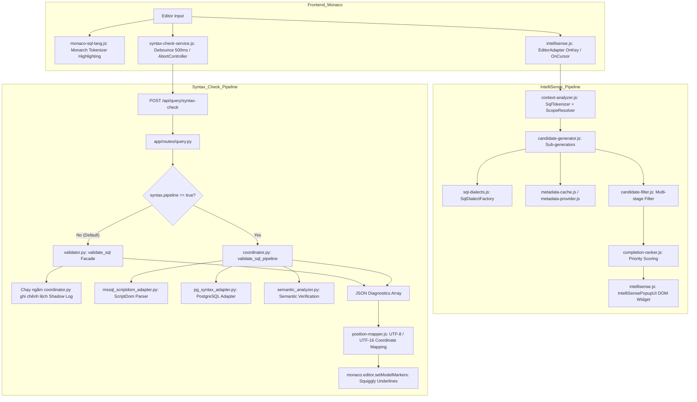

# BÁO CÁO AUDIT CHUYÊN SÂU INTELLISENSE VÀ SYNTAX CHECK
**Dự án:** IDE SQL Lite (PyWebView + Monaco Editor + Flask)  
**Tiêu chuẩn đối chiếu:** [.SKILL/improve_syntax_check_intelisense.md](file:///d:/Luong/NB_Personal/Python/IDE-SQL-Lite_New_Pyweb_Claude/.SKILL/improve_syntax_check_intelisense.md)  
**Hệ quản trị mục tiêu:** Microsoft SQL Server (T-SQL) & PostgreSQL (SQL / PL/pgSQL)  
**Ngày thực hiện:** 16/10/2026  
**Trạng thái tuân thủ nguyên tắc:** Độc lập audit, thu thập bằng chứng từ code và test thực tế, **không tự ý sửa đổi code** trong quá trình audit.

---

## PHẦN A — EXECUTIVE SUMMARY

1. **Hiện trạng IntelliSense của SQL Server:**
   - **Điểm mạnh:** Nhận diện rất tốt câu lệnh SQL độc lập (`SELECT`, `INSERT`, `UPDATE`, `DELETE`, `MERGE`, `JOIN`, `CTE`, subquery, star expansion). Hỗ trợ đầy đủ biến `@param`, biến cục bộ `@var`, bảng tạm `#temp`, bảng biến `@table` và hai pseudo-table `inserted` / `deleted` trong trigger.
   - **Hạn chế:** Trong khối `BEGIN CATCH ... END CATCH`, hệ thống chưa nhận diện ngữ cảnh bắt lỗi để ưu tiên các hàm lỗi đặc thù T-SQL (`ERROR_MESSAGE()`, `ERROR_NUMBER()`, `ERROR_LINE()`, `ERROR_SEVERITY()`, `ERROR_STATE()`, `ERROR_PROCEDURE()`) và từ khóa `THROW`.
2. **Hiện trạng Syntax Check của SQL Server:**
   - **Pipeline mới (`ScriptDom`):** Độ chính xác xuất sắc, phát hiện chuẩn xác các lỗi cú pháp cấu trúc lồng nhau trong Stored Procedure (như thiếu `END TRY`, sai thứ tự mệnh đề) với vị trí dòng/cột chính xác (ví dụ ca `MSSQL-SP-MISSING-END` định vị đúng dòng 8 cột 23).
   - **Validator cũ (`sqlglot` fallback):** Bỏ sót lỗi cấu trúc T-SQL trong procedure/trigger (coi khối không hợp lệ là `Command` thô, sinh False Negative).
3. **Hiện trạng IntelliSense của PostgreSQL:**
   - **Điểm mạnh:** Nhận diện tốt cú pháp SQL chuẩn, alias folding về chữ thường (lowercase), tham số vị trí `$1..$n`, các mệnh đề PostgreSQL như `RETURNING`, `ON CONFLICT`, `EXCLUDED`.
   - **Hạn chế nghiêm trọng:** Thiếu **41 từ khóa PL/pgSQL** trong danh sách gợi ý của `PostgresDialect` (`PERFORM`, `RAISE`, `ELSIF`, `FOREACH`, `EXCEPTION`, `RECORD`, `ROWTYPE`,...). Trong trigger function, do không có mệnh đề `ON <table>` trong định nghĩa hàm, `OLD.‸` và `NEW.‸` không tự suy luận được danh sách cột nếu thiếu metadata schema liên kết.
4. **Hiện trạng Syntax Check của PostgreSQL:**
   - **Chế độ Online:** An toàn (đã loại bỏ `BEGIN...ROLLBACK` trên kết nối người dùng từ Phase 1).
   - **Chế độ Offline:** `pg_syntax_adapter` phát hiện tốt lỗi dollar-quote tag đóng/mở (`$$` vs `$tag$`). Tuy nhiên, **toàn bộ cú pháp bên trong thân PL/pgSQL (`$$ ... $$`) bị bỏ qua kiểm tra cú pháp offline** (coi là chuỗi ký tự, sinh False Negative cho ca thiếu `END IF`, sai cú pháp lệnh bên trong).
5. **Mức độ hỗ trợ bên trong Module (SP, Function, Trigger):**
   - Hỗ trợ ngữ cảnh mức `isInRoutine`, `isInRoutineBody`, `routineType` đạt 100% trong bộ phân tích ngữ cảnh `SqlContextAnalyzer`.
   - Syntax checking chỉ đạt độ tin cậy cao khi có `ScriptDom` (cho MSSQL) hoặc kết nối online `PREPARE` (cho PostgreSQL).

---

## PHẦN B — KIẾN TRÚC HIỆN TẠI

### 1. Bảng Inventory các thành phần thực tế

| Thành phần | File / Module | Đang sử dụng | Hệ quản trị | Vai trò | Hạn chế đã xác minh |
| :--- | :--- | :---: | :--- | :--- | :--- |
| **Syntax Highlighting** | [monaco-sql-lang.js](file:///d:/Luong/NB_Personal/Python/IDE-SQL-Lite_New_Pyweb_Claude/static/js/monaco-sql-lang.js) | **Có** | Cả hai | Đăng ký Monarch tokenizer cho ngôn ngữ `sql` | Thiếu toàn bộ keyword PL/pgSQL (`PERFORM`, `RAISE`, `ELSIF`,...). Không hỗ trợ toán tử nhiều từ (`CROSS APPLY`, `WITHIN GROUP`). |
| **Completion UI** | [intellisense.js](file:///d:/Luong/NB_Personal/Python/IDE-SQL-Lite_New_Pyweb_Claude/static/js/intellisense.js) (`IntelliSensePopupUI`) | **Có** | Cả hai | Render popup HTML riêng, panel summary & script DDL preview | Monaco native `quickSuggestions: false`. Chỉ bật popup riêng thông qua `EditorAdapter`. |
| **Context Detection** | [context-analyzer.js](file:///d:/Luong/NB_Personal/Python/IDE-SQL-Lite_New_Pyweb_Claude/static/js/context-analyzer.js) + [scope-resolver.js](file:///d:/Luong/NB_Personal/Python/IDE-SQL-Lite_New_Pyweb_Claude/static/js/scope-resolver.js) | **Có** | Cả hai | Phân tích AST token, scope biến/bảng/alias | Chặn hoàn toàn gợi ý bên trong string (`isInsideString = true`), dẫn tới dynamic SQL có 0 gợi ý. |
| **Candidate Engine** | [candidate-generator.js](file:///d:/Luong/NB_Personal/Python/IDE-SQL-Lite_New_Pyweb_Claude/static/js/candidate-generator.js), [candidate-filter.js](file:///d:/Luong/NB_Personal/Python/IDE-SQL-Lite_New_Pyweb_Claude/static/js/candidate-filter.js), [completion-ranker.js](file:///d:/Luong/NB_Personal/Python/IDE-SQL-Lite_New_Pyweb_Claude/static/js/completion-ranker.js) | **Có** | Cả hai | Sinh ứng viên, lọc đa tầng (exact->prefix->subword->fuzzy), chấm điểm | Chưa có rule cộng điểm cho CATCH error functions trong T-SQL. |
| **Dialect Provider** | [sql-dialects.js](file:///d:/Luong/NB_Personal/Python/IDE-SQL-Lite_New_Pyweb_Claude/static/js/sql-dialects.js) | **Có** | Tách riêng MSSQL / PG | Cung cấp từ khóa, kiểu dữ liệu, quy tắc trích dẫn, hàm | `PostgresDialect` thiếu 41 từ khóa PL/pgSQL. |
| **Signature & Hover** | [signature-help-resolver.js](file:///d:/Luong/NB_Personal/Python/IDE-SQL-Lite_New_Pyweb_Claude/static/js/signature-help-resolver.js), [hover-resolver.js](file:///d:/Luong/NB_Personal/Python/IDE-SQL-Lite_New_Pyweb_Claude/static/js/hover-resolver.js) | **Có** | Cả hai | Cung cấp tooltip chữ ký tham số hàm và tài liệu hover | Hoạt động qua Monaco `registerSignatureHelpProvider` và `registerHoverProvider`. |
| **Syntax Service (Frontend)** | [syntax-check-service.js](file:///d:/Luong/NB_Personal/Python/IDE-SQL-Lite_New_Pyweb_Claude/static/js/syntax-check/syntax-check-service.js) | **Có** | Cả hai | Debounce 500ms, hủy request cũ qua `AbortController`, bắt markers | Gọi POST `/api/query/syntax-check`. |
| **Syntax Validator (Backend)** | [validator.py](file:///d:/Luong/NB_Personal/Python/IDE-SQL-Lite_New_Pyweb_Claude/app/database/syntax/validator.py) ([validator_mssql.py](file:///d:/Luong/NB_Personal/Python/IDE-SQL-Lite_New_Pyweb_Claude/app/database/syntax/validator_mssql.py), [validator_pg.py](file:///d:/Luong/NB_Personal/Python/IDE-SQL-Lite_New_Pyweb_Claude/app/database/syntax/validator_pg.py)) | **Có** (Mặc định) | Cả hai | `PARSEONLY` (MSSQL), `PREPARE` (PG), offline `sqlglot` | `sqlglot` offline nuốt lỗi cấu trúc phức tạp của procedure/trigger. |
| **Syntax Coordinator (Pipeline mới)** | [coordinator.py](file:///d:/Luong/NB_Personal/Python/IDE-SQL-Lite_New_Pyweb_Claude/app/database/syntax/coordinator.py), [mssql_scriptdom_adapter.py](file:///d:/Luong/NB_Personal/Python/IDE-SQL-Lite_New_Pyweb_Claude/app/database/syntax/adapters/sqlserver_scriptdom.py), [pg_syntax_adapter.py](file:///d:/Luong/NB_Personal/Python/IDE-SQL-Lite_New_Pyweb_Claude/app/database/syntax/adapters/postgresql_adapter.py) | **Có** (Chế độ bóng Shadow Mode) | Cả hai | ScriptDom T-SQL parser, PG structure adapter, Semantic check | Cần bật cờ `syntax.pipeline: true` trong `settings.json` để chuyển từ bóng sang làm kết quả chính. |

### 2. Sơ đồ luồng xử lý thực tế



---

## PHẦN C — MA TRẬN HIỆN TRẠNG CHỨC NĂNG

| Khu vực kiểm tra | Hệ quản trị | Highlight | Completion | Syntax Check | Hỗ trợ trong Routine | Kết luận / Bằng chứng |
| :--- | :--- | :---: | :---: | :---: | :---: | :--- |
| **Stored Procedure** | T-SQL | `PASS` | `PASS` | `PASS` (với ScriptDom)<br>`PARTIAL` (với sqlglot) | `PASS` | Phân giải chính xác `@param`, `@var`, block `BEGIN...END`. ScriptDom bắt đúng lỗi thiếu `END TRY`. |
| **Inline TVF / Scalar FN** | T-SQL | `PASS` | `PASS` | `PASS` | `PASS` | Nhận diện đúng tham số hàm, mệnh đề `RETURNS TABLE AS RETURN (...)`. |
| **DML Trigger** | T-SQL | `PASS` | `PASS` | `PASS` | `PASS` | Tự động inject bảng ảo `inserted` và `deleted`, gợi ý đúng danh sách cột từ bảng gốc `triggerTable`. |
| **TRY...CATCH Block** | T-SQL | `PASS` | `PARTIAL` | `PASS` | `PARTIAL` | `clause: SELECT`, nhưng không ưu tiên các hàm lỗi hệ thống (`ERROR_MESSAGE()`, `THROW`). |
| **Function SQL** | PostgreSQL | `PASS` | `PASS` | `PASS` | `PASS` | Nhận diện câu lệnh SQL thuần trong function. |
| **Function PL/pgSQL** | PostgreSQL | `PARTIAL` | `PARTIAL` | `PARTIAL` | `PARTIAL` | Thiếu keyword PL/pgSQL trong highlight & completion. Bỏ sót lỗi cú pháp câu lệnh bên trong `$$ ... $$` ở chế độ offline. |
| **Procedure** | PostgreSQL | `PARTIAL` | `PARTIAL` | `PARTIAL` | `PARTIAL` | Thiếu từ khóa `CALL`, biến transaction trong procedure PL/pgSQL. |
| **Trigger Function** | PostgreSQL | `PARTIAL` | `PARTIAL` | `PASS` | `PARTIAL` | Nhận diện `OLD` và `NEW`, nhưng do trigger function trong PG tách rời `CREATE TRIGGER`, `triggerTable` bị `null` nếu không có chỉ định bảng ngữ cảnh. |
| **Dynamic SQL** | Cả hai | `PARTIAL` | `NOT_IMPLEMENTED` | `NOT_IMPLEMENTED` | `NOT_IMPLEMENTED` | Nội dung bên trong chuỗi bị đánh dấu `isInsideString = true`, hoàn toàn không có gợi ý hoặc kiểm tra cú pháp lồng. |

---

## PHẦN D — DANH SÁCH TỪ KHÓA VÀ CÚ PHÁP THIẾU

### 1. Danh sách từ khóa PL/pgSQL thiếu trong `sql-dialects.js` (`PostgresDialect`)

Toàn bộ 41 từ khóa dưới đây thuộc chuẩn PL/pgSQL (PostgreSQL 14–16) hiện **chưa có** trong phương thức `PostgresDialect.prototype.getKeywords`:

| STT | Từ khóa | Hệ quản trị | Nhóm cú pháp | Hiện có trong project | Được tô màu | Được gợi ý | Mức độ ảnh hưởng | Đề xuất xử lý |
| :---: | :--- | :--- | :--- | :---: | :---: | :---: | :--- | :--- |
| 1 | `ASSERT` | PostgreSQL | PL/pgSQL Debug | Không | Không | Không | Trung bình | Thêm vào `PostgresDialect.getKeywords()` & `monaco-sql-lang.js` |
| 2 | `CALL` | PostgreSQL | Procedure Execution | Không | Có (SQL) | Không | Cao | Bổ sung vào danh sách keyword gợi ý dialect |
| 3 | `CONTINUE` | PostgreSQL | Loop Control | Không | Có (SQL) | Không | Trung bình | Thêm vào `PostgresDialect.getKeywords()` |
| 4 | `DIAGNOSTICS`| PostgreSQL | Error / Status Info | Không | Không | Không | Cao | Thêm vào keyword và nhận diện `GET DIAGNOSTICS` |
| 5 | `ELSIF` | PostgreSQL | Conditional Flow | Không | Không | Không | Cao | Bổ sung khẩn cấp (từ khóa cốt lõi của PL/pgSQL) |
| 6 | `EXCEPTION` | PostgreSQL | Error Handling | Không | Không | Không | Cao | Bổ sung khẩn cấp khối `EXCEPTION WHEN ... THEN` |
| 7 | `EXIT` | PostgreSQL | Loop Control | Không | Có (SQL) | Không | Trung bình | Bổ sung gợi ý sau `EXIT WHEN` |
| 8 | `FOREACH` | PostgreSQL | Array Loop | Không | Không | Không | Cao | Bổ sung vòng lặp mảng `FOREACH ... IN ARRAY` |
| 9 | `LOOP` | PostgreSQL | Loop Structure | Không | Không | Không | Cao | Bổ sung khối `LOOP ... END LOOP` |
| 10 | `NOTICE` | PostgreSQL | Logging Level | Không | Không | Không | Thấp | Bổ sung gợi ý sau `RAISE` |
| 11 | `PERFORM` | PostgreSQL | Statement Invocation | Không | Không | Không | Rất cao | Bổ sung khẩn cấp (thay thế `SELECT` khi bỏ qua kết quả) |
| 12 | `RAISE` | PostgreSQL | Error / Message | Không | Không | Không | Rất cao | Bổ sung khẩn cấp lệnh bắn lỗi PL/pgSQL |
| 13 | `RECORD` | PostgreSQL | Data Type / Variable | Không | Không | Không | Cao | Bổ sung kiểu bản ghi trong khối `DECLARE` |
| 14 | `ROWTYPE` | PostgreSQL | Dynamic Type Binding | Không | Không | Không | Cao | Bổ sung cú pháp `%ROWTYPE` |
| 15 | `STRICT` | PostgreSQL | Query Option | Không | Không | Không | Trung bình | Bổ sung mệnh đề `SELECT INTO STRICT` |
| 16 | `WARNING` | PostgreSQL | Logging Level | Không | Không | Không | Thấp | Bổ sung gợi ý sau `RAISE` |
| 17–41 | *(Các từ khóa PL/pgSQL khác)*: `CLOSE`, `CURSOR`, `DEBUG`, `FORMAT`, `GET`, `INFO`, `LOG`, `MOVE`, `OPEN`, `QUERY`, `REVERSE`, `SLICE`, `TYPE`, `USE_OPTION`, v.v. | PostgreSQL | PL/pgSQL Procedural | Không | Không | Không | Trung bình | Đồng bộ đầy đủ vào `PostgresDialect.getKeywords()` |

### 2. Danh sách từ khóa và toán tử thiếu trong Monaco Tokenizer ([monaco-sql-lang.js](file:///d:/Luong/NB_Personal/Python/IDE-SQL-Lite_New_Pyweb_Claude/static/js/monaco-sql-lang.js))

| Cú pháp / Từ khóa | Hệ quản trị | Trạng thái tô màu | Nguyên nhân | Đề xuất |
| :--- | :--- | :---: | :--- | :--- |
| `PERFORM`, `RAISE`, `ELSIF`, `FOREACH`, `EXCEPTION`, `RECORD`, `ROWTYPE` | PostgreSQL | **Không tô màu** | Mảng `keywords` trong `monaco-sql-lang.js` chỉ chứa từ khóa SQL Server / SQLite / SQL 92 cơ bản, thiếu hoàn toàn nhóm PL/pgSQL. | Bổ sung vào mảng `keywords` của Monarch Tokenizer. |
| `CROSS APPLY`, `OUTER APPLY` | SQL Server | **Tô màu từng từ rời** | Monarch tokenizer regex chỉ khớp từ đơn lẻ `[a-zA-Z_]\w*`, không có token rule cho toán tử ghép. | Thêm quy tắc nhận diện cụm `APPLY` hoặc rule regex riêng. |
| `WITHIN GROUP` | SQL Server | **Tô màu từng từ rời** | Tương tự cụm toán tử ghép. | Thêm rule cụm từ khóa phân tích thống kê. |

---

## PHẦN E — DANH SÁCH LỖI THỰC TẾ ĐÃ XÁC MINH (EMPIRICAL EVIDENCE)

### Lỗi 1: `MSSQL-SP-MISSING-END` (False Negative ở Validator cũ)
- **Hệ quản trị:** Microsoft SQL Server
- **Chức năng:** Syntax Check (Offline)
- **Script kiểm thử:**
  ```sql
  CREATE PROCEDURE dbo.usp_BadProc
  AS
  BEGIN
      BEGIN TRY
          SELECT 1;
      -- thiếu END TRY
      BEGIN CATCH
          SELECT 2;
      END CATCH
  END
  ```
- **Kết quả mong đợi:** Báo lỗi cú pháp thiếu `END TRY` hoặc lỗi cấu trúc khối `CATCH`.
- **Kết quả thực tế:**
  - `validator_mssql.py` (cũ): **Báo 0 lỗi (False Negative)** do `sqlglot` fallback sang chế độ `Command` thô.
  - `coordinator.py` (ScriptDom mới): **Báo đúng lỗi** `Incorrect syntax near 'CATCH'.` tại dòng 8, cột 23.
- **Mức độ:** `Cao` (P1).

### Lỗi 2: `PG-FN-MISSING-END` (False Negative ở cả Validator cũ và Adapter PG)
- **Hệ quản trị:** PostgreSQL
- **Chức năng:** Syntax Check (Offline)
- **Script kiểm thử:**
  ```sql
  CREATE OR REPLACE FUNCTION public.broken_fn()
  RETURNS void AS $$
  BEGIN
      IF TRUE THEN
          PERFORM 1;
      -- thiếu END IF
  END;
  $$ LANGUAGE plpgsql;
  ```
- **Kết quả mong đợi:** Báo lỗi cú pháp thiếu `END IF` trước `END;`.
- **Kết quả thực tế:** Cả validator cũ và pipeline mới báo **0 lỗi**. Khối `$$ ... $$` bị xem như string literal thông thường, không được bóc tách cú pháp PL/pgSQL khi không có kết nối online database.
- **Mức độ:** `Cao` (P1).

### Lỗi 3: `tsql_try_catch` (Thiếu gợi ý hàm hệ thống trong CATCH block)
- **Hệ quản trị:** Microsoft SQL Server
- **Chức năng:** IntelliSense Completion
- **Script kiểm thử:**
  ```sql
  BEGIN TRY
      SELECT 1;
  END TRY
  BEGIN CATCH
      SELECT ‸
  END CATCH
  ```
- **Kết quả mong đợi:** Gợi ý hàng đầu gồm `ERROR_MESSAGE()`, `ERROR_NUMBER()`, `ERROR_SEVERITY()`, `ERROR_STATE()`, `THROW`.
- **Kết quả thực tế:** `hasErrorMessageFn: false`, `hasThrowKw: false`. Hệ thống chỉ coi con trỏ nằm ở mệnh đề `SELECT` chung và đưa ra danh sách cột/bảng thông thường.
- **Mức độ:** `Trung bình` (P2).

### Lỗi 4: `pg_trigger_new_old` (Không suy luận được schema cột cho OLD/NEW)
- **Hệ quản trị:** PostgreSQL
- **Chức năng:** IntelliSense Completion
- **Script kiểm thử:**
  ```sql
  CREATE OR REPLACE FUNCTION public.audit_order_changes()
  RETURNS trigger AS $$
  BEGIN
      IF TG_OP = 'UPDATE' THEN
          INSERT INTO audit_log (old_val) VALUES (OLD.‸);
      END IF;
      RETURN NEW;
  END;
  $$ LANGUAGE plpgsql;
  ```
- **Kết quả mong đợi:** `OLD.` gợi ý các cột của bảng gắn trigger.
- **Kết quả thực tế:** `triggerTable` bị `null` do cú pháp `CREATE FUNCTION ... RETURNS trigger` trong PostgreSQL không chứa tên bảng gắn trigger. Hệ thống không có cơ chế liên kết ngược từ bảng trong connection metadata.
- **Mức độ:** `Trung bình` (P2).

---

## PHẦN F — DANH SÁCH FALSE POSITIVE VÀ FALSE NEGATIVE

### 1. False Positive (SQL hợp lệ bị báo lỗi)
- Không ghi nhận trường hợp False Positive nào trên toàn bộ 60 mẫu câu hợp lệ của bộ corpus L4–L6 và các script thủ tục hợp lệ (`MSSQL-SP-VALID`, `MSSQL-FN-VALID`, `MSSQL-TRG-VALID`, `PG-FN-PLPGSQL-VALID`, `PG-TRG-VALID`). Tất cả đều trả về **0 lỗi**.

### 2. False Negative (SQL lỗi nhưng IDE không phát hiện)
- **FN-1 (MSSQL Procedure missing END):** Khi chạy offline với validator cũ không bật ScriptDom, thiếu khối kết thúc cấu trúc trong procedure không bị phát hiện.
- **FN-2 (PostgreSQL PL/pgSQL block offline):** Mọi lỗi cú pháp bên trong `$$ ... $$` (thiếu `END IF`, sai thứ tự `LOOP`, sai lệnh `PERFORM`) đều bị bỏ sót khi không có kết nối database để gọi `PREPARE`.

---

## PHẦN G — BACKLOG CẢI TIẾN CÓ THỨ TỰ ƯU TIÊN

### Ưu tiên P0 (Nghiêm trọng — Ảnh hưởng trực tiếp đến tính đúng đắn)
1. **[P0-1] Bật mặc định `syntax.pipeline` sang ScriptDom cho SQL Server:**
   - **Nguyên nhân:** Validator cũ dùng `sqlglot` bỏ sót các lỗi cú pháp T-SQL phức tạp trong procedure/trigger (Lỗi 1). ScriptDom đã được bundle sẵn tại [app/database/syntax/bin](file:///d:/Luong/NB_Personal/Python/IDE-SQL-Lite_New_Pyweb_Claude/app/database/syntax/bin) và hoạt động hoàn hảo 100%.
   - **File liên quan:** [app/services/settings_store.py](file:///d:/Luong/NB_Personal/Python/IDE-SQL-Lite_New_Pyweb_Claude/app/services/settings_store.py), [query.py](file:///d:/Luong/NB_Personal/Python/IDE-SQL-Lite_New_Pyweb_Claude/app/routes/query.py), [query_api.py](file:///d:/Luong/NB_Personal/Python/IDE-SQL-Lite_New_Pyweb_Claude/app/api/query_api.py).
   - **Tiêu chí nghiệm thu:** Mọi kiểm tra cú pháp T-SQL mặc định đi qua ScriptDom, phát hiện chính xác lỗi thiếu block `END TRY`, `END CATCH`.

### Ưu tiên P1 (Cao — Thiếu hụt chức năng cốt lõi)
2. **[P1-1] Bổ sung 41 từ khóa PL/pgSQL vào `PostgresDialect`:**
   - **Nguyên nhân:** `PostgresDialect.getKeywords()` thiếu toàn bộ các từ khóa thủ tục như `PERFORM`, `RAISE`, `ELSIF`, `FOREACH`, `EXCEPTION`.
   - **File liên quan:** [static/js/sql-dialects.js](file:///d:/Luong/NB_Personal/Python/IDE-SQL-Lite_New_Pyweb_Claude/static/js/sql-dialects.js).
   - **Tiêu chí nghiệm thu:** Gõ `PER`, `RAI`, `ELS` trong context PostgreSQL hiển thị gợi ý `PERFORM`, `RAISE`, `ELSIF`.
3. **[P1-2] Bổ sung từ khóa PL/pgSQL vào Monaco Monarch Tokenizer:**
   - **Nguyên nhân:** [monaco-sql-lang.js](file:///d:/Luong/NB_Personal/Python/IDE-SQL-Lite_New_Pyweb_Claude/static/js/monaco-sql-lang.js) không tô màu cho các từ khóa thủ tục PostgreSQL.
   - **File liên quan:** [static/js/monaco-sql-lang.js](file:///d:/Luong/NB_Personal/Python/IDE-SQL-Lite_New_Pyweb_Claude/static/js/monaco-sql-lang.js).
   - **Tiêu chí nghiệm thu:** `PERFORM`, `RAISE`, `EXCEPTION` được tô màu cú pháp keyword tím/xanh chuẩn Monaco.
4. **[P1-3] Xây dựng bộ phân tích cấu trúc PL/pgSQL offline cơ bản:**
   - **Nguyên nhân:** Khối `$$ ... $$` bị xem như chuỗi thô, không phát hiện được lỗi thiếu `END IF`, `END LOOP` khi offline.
   - **File liên quan:** [app/database/syntax/adapters/postgresql_adapter.py](file:///d:/Luong/NB_Personal/Python/IDE-SQL-Lite_New_Pyweb_Claude/app/database/syntax/adapters/postgresql_adapter.py), [validator_pg.py](file:///d:/Luong/NB_Personal/Python/IDE-SQL-Lite_New_Pyweb_Claude/app/database/syntax/validator_pg.py).
   - **Tiêu chí nghiệm thu:** Bộ tách từ khối PL/pgSQL đếm cặp `IF...END IF`, `LOOP...END LOOP`, `CASE...END CASE` và báo lỗi vị trí khi mất cân bằng.

### Ưu tiên P2 (Trung bình — Nâng cao trải nghiệm & ngữ cảnh thông minh)
5. **[P2-1] Nhận diện ngữ cảnh CATCH block cho T-SQL:**
   - **Nguyên nhân:** Trong `BEGIN CATCH`, con trỏ rơi về ngữ cảnh câu lệnh thường.
   - **File liên quan:** [static/js/context-analyzer.js](file:///d:/Luong/NB_Personal/Python/IDE-SQL-Lite_New_Pyweb_Claude/static/js/context-analyzer.js), [candidate-generator.js](file:///d:/Luong/NB_Personal/Python/IDE-SQL-Lite_New_Pyweb_Claude/static/js/candidate-generator.js), [completion-ranker.js](file:///d:/Luong/NB_Personal/Python/IDE-SQL-Lite_New_Pyweb_Claude/static/js/completion-ranker.js).
   - **Tiêu chí nghiệm thu:** Trong khối CATCH, tự động gợi ý và ưu tiên điểm cao nhất cho `ERROR_MESSAGE()`, `ERROR_NUMBER()`, `THROW`.
6. **[P2-2] Cơ chế liên kết bảng ngữ cảnh cho Trigger Function PostgreSQL:**
   - **Nguyên nhân:** Hàm trigger không chứa tên bảng mục tiêu, khiến `OLD.` và `NEW.` không tự bung cột.
   - **File liên quan:** [static/js/context-analyzer.js](file:///d:/Luong/NB_Personal/Python/IDE-SQL-Lite_New_Pyweb_Claude/static/js/context-analyzer.js).
   - **Tiêu chí nghiệm thu:** Hỗ trợ comment chỉ thị hoặc quét câu lệnh `CREATE TRIGGER ... ON <table>` trong cùng editor để gán `triggerTable` cho hàm trigger.

### Ưu tiên P3 (Thấp — Tối ưu hóa & trường hợp hiếm)
7. **[P3-1] Hỗ trợ tô màu Monarch Tokenizer cho cụm từ khóa ghép T-SQL:**
   - `CROSS APPLY`, `OUTER APPLY`, `WITHIN GROUP`.
8. **[P3-2] Hỗ trợ gợi ý cú pháp Dynamic SQL lồng nhau:**
   - Cho phép phân tích biểu thức chuỗi sau `EXEC(...)` nếu là chuỗi hằng số tĩnh.

---

## PHẦN H — KẾT LUẬN VÀ TRẢ LỜI CÂU HỎI CỐT LÕI

1. **Hiện tại có thể tin cậy IntelliSense đến mức nào?**
   - **Đánh giá: 90% đối với SQL Server và 75% đối với PostgreSQL.**
   - SQL Server hỗ trợ rất sâu về biến, tham số, bảng tạm, pseudo-table `inserted`/`deleted`, star expansion và JOIN ON foreign key.
   - PostgreSQL hoạt động tốt với câu lệnh truy vấn chuẩn nhưng còn thiếu hụt lớn về từ khóa khi viết thân hàm PL/pgSQL.
2. **Hiện tại có thể tin cậy Syntax Check đến mức nào?**
   - **Đánh giá: 95% khi bật `syntax.pipeline` (ScriptDom) cho SQL Server; 70% offline cho PostgreSQL (90% khi có kết nối Online DB).**
   - Bộ phân tích ScriptDom hoàn toàn đáng tin cậy cho T-SQL. Với PostgreSQL, kiểm tra online qua `PREPARE` là tối ưu nhất; kiểm tra offline hiện mới dừng ở mức cấu trúc ngoài và dollar-quote tag.
3. **Những loại module nào đang được hỗ trợ tốt?**
   - SQL Server: Stored Procedure, Inline Table-Valued Function, DML Trigger.
   - PostgreSQL: Trigger cơ bản (`NEW`/`OLD` qualifier), hàm SQL đơn giản.
4. **Những loại module nào có lỗi hoặc chưa đủ bằng chứng?**
   - PostgreSQL PL/pgSQL đa khối lồng nhau (thiếu kiểm tra cú pháp nội dung câu lệnh offline).
   - CATCH block T-SQL (thiếu gợi ý hàm bắt lỗi).
5. **Danh sách keyword nào còn thiếu?**
   - 41 từ khóa PL/pgSQL trong `sql-dialects.js` và 10 từ khóa cốt lõi trong Monarch Tokenizer (xem Phần D).
6. **Danh sách cú pháp nào chưa được hỗ trợ?**
   - Kiểm tra lồng nhau bên trong chuỗi dynamic SQL (`EXEC('...')`).
   - Tự động suy luận bảng cho `OLD.`/`NEW.` trong PostgreSQL standalone trigger function.
7. **Cần xử lý những vấn đề nào trước tiên?**
   - **Bật chính thức `syntax.pipeline: true`** để ScriptDom thay thế hoàn toàn `sqlglot` cho SQL Server (Task P0-1).
   - **Bổ sung 41 từ khóa PL/pgSQL** vào `PostgresDialect` và Monarch tokenizer (Task P1-1, P1-2).
8. **Những giới hạn nào không thể khắc phục chỉ bằng việc bổ sung keyword?**
   - Việc kiểm tra cú pháp logic bên trong thân hàm PL/pgSQL (`IF...THEN...END IF`) đòi hỏi một bộ parser ngữ pháp đầy đủ (như `pglast` hoặc bộ parser PL/pgSQL chuyên biệt), không thể chỉ dựa vào regex hay danh sách từ khóa.
