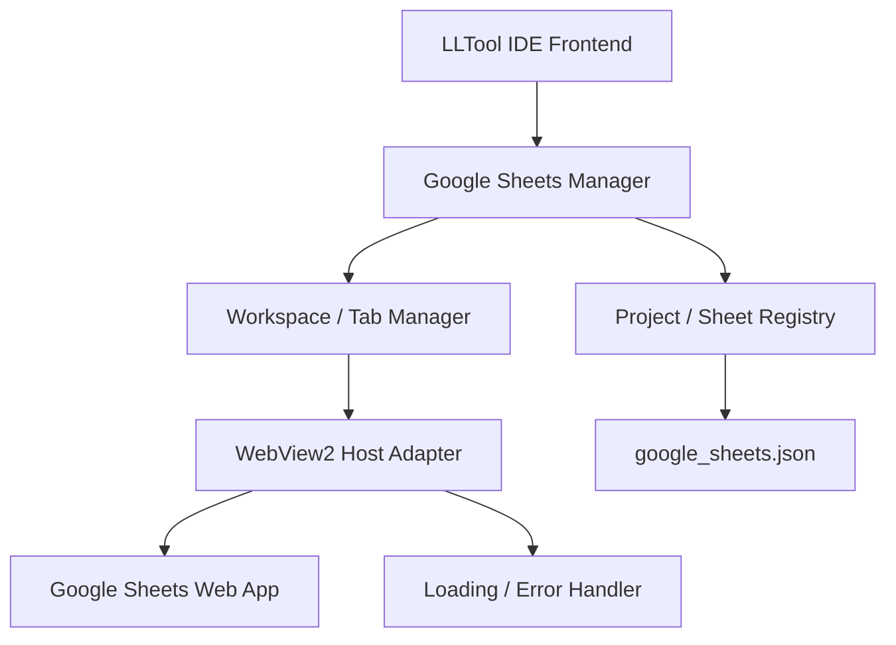

# KẾ HOẠCH TRIỂN KHAI GOOGLE SHEETS TÍCH HỢP VÀO LLTOOL IDE

* **Trạng thái:** Đã chốt yêu cầu, cần khảo sát dự án trước khi triển khai.
* **Phạm vi:** MVP quản lý danh mục Google Sheets theo dự án và mở/chỉnh sửa tài liệu trực tiếp trong IDE.
* **Phương án hiển thị:** WebView2 riêng trong cửa sổ IDE.
* **Tài khoản:** Sử dụng tài khoản Google hiện có.
* **Nguyên tắc ưu tiên:** Tách biệt module, tuân thủ giao diện hiện tại, không ảnh hưởng chức năng SQL/XML và dữ liệu người dùng.

---

# 1. MỤC TIÊU

Xây dựng tính năng quản lý Google Sheets tích hợp vào LLTool IDE, cho phép người dùng quản lý nhiều bảng tính theo từng dự án và mở trực tiếp tài liệu trong IDE.

Luồng sử dụng chính:

1. Người dùng sao chép link Google Sheets.
2. Người dùng chọn dự án trong LLTool IDE.
3. Người dùng dán link và thêm tài liệu vào danh mục.
4. Người dùng mở tài liệu từ danh sách.
5. LLTool hiển thị giao diện Google Sheets thực tế trong vùng WebView2 tích hợp với cửa sổ IDE.
6. Người dùng xem và chỉnh sửa trực tiếp theo quyền của tài khoản Google.
7. Google chịu trách nhiệm lưu và đồng bộ nội dung bảng tính.

## 1.1. Nguyên tắc quan trọng

* Google Sheets vẫn là nguồn dữ liệu gốc.
* Không sao chép nội dung các ô tính vào database riêng của LLTool.
* Không tự xây dựng giao diện bảng tính thay thế Google Sheets.
* Không sử dụng trang preview thay cho giao diện chỉnh sửa.
* Không tự động thay đổi quyền chia sẻ của tài liệu.
* Không yêu cầu người dùng công khai tài liệu để có thể mở trong IDE.
* Không xây dựng Google Sheets API trong MVP nếu chưa có nhu cầu cụ thể.
* Không đánh đổi tính ổn định của IDE để cố gắng nhúng bằng mọi giá.

# 2. PHẠM VI CHỨC NĂNG MVP

| Chức năng      | Yêu cầu                                                                      |
| -------------- | ---------------------------------------------------------------------------- |
| Quản lý dự án  | Tạo, đổi tên, xóa và xem danh sách dự án                                     |
| Quản lý Sheet  | Thêm, sửa tên hiển thị, xóa liên kết và ghim yêu thích                       |
| Thêm tài liệu  | Dán URL Google Sheets                                                        |
| Tổ chức        | Mỗi dự án có nhiều Google Sheets                                             |
| Tìm kiếm       | Tìm theo tên hiển thị, tên dự án hoặc Spreadsheet ID                         |
| Hiển thị       | WebView2 riêng tích hợp vào cửa sổ IDE                                       |
| Chỉnh sửa      | Sử dụng giao diện Google Sheets nguyên bản                                   |
| Quyền truy cập | Tuân theo quyền Google của tài khoản hiện tại                                |
| Lưu dữ liệu    | Lưu metadata vào file cấu hình riêng                                         |
| Khôi phục      | Khôi phục danh mục sau khi khởi động lại                                     |
| Dự phòng       | Mở bằng trình duyệt mặc định khi WebView2 không đáp ứng                      |
| Ngoài phạm vi  | Google Sheets API, đồng bộ dữ liệu vào SQL, tự động chỉnh sửa nội dung Sheet |

# 3. QUY TẮC KIẾN TRÚC BẮT BUỘC

## 3.1. Không viết logic vào main

Đây là quy tắc bắt buộc.

* Không viết logic nghiệp vụ Google Sheets trực tiếp trong `main.py`.
* Không dồn toàn bộ logic vào file khởi tạo ứng dụng.
* Không đưa logic quản lý danh mục, xử lý URL, quản lý tab hoặc vòng đời WebView2 vào module điều phối trung tâm.
* Chỉ được sửa file khởi tạo chính khi thật sự cần để đăng ký hoặc kết nối module mới.
* Mọi thay đổi tại file chính phải được giải thích rõ trong báo cáo phạm vi tác động.
* Không refactor các module không liên quan để phục vụ tính năng này.

## 3.2. Tách riêng Python, JavaScript, CSS và HTML

Bắt buộc:

* Logic backend Python phải nằm trong module riêng.
* Logic giao diện JavaScript phải nằm trong file `.js` riêng.
* CSS phải nằm trong file `.css` riêng.
* HTML chỉ chứa cấu trúc giao diện và tham chiếu đến tài nguyên bên ngoài.
* Không nhúng JavaScript trực tiếp vào HTML.
* Không nhúng CSS trực tiếp vào HTML.
* Không tạo các đoạn JavaScript hoặc CSS inline từ Python backend.
* Không gộp toàn bộ module vào một file duy nhất.

Trước khi tạo file mới, agent phải khảo sát quy tắc đặt tên và cách tổ chức module hiện tại của dự án.

## 3.3. Cấu trúc thư mục tham khảo

Cấu trúc sau chỉ là đề xuất, phải điều chỉnh dựa trên cấu trúc thực tế của LLTool IDE.

```text
project/
├── main.py
│
├── backend/
│   └── google_sheets/
│       ├── __init__.py
│       ├── service.py
│       ├── registry.py
│       ├── url_parser.py
│       └── webview_host.py
│
├── static/
│   ├── js/
│   │   └── google-sheets/
│   │       ├── manager.js
│   │       ├── tabs.js
│   │       └── view.js
│   │
│   └── css/
│       └── google-sheets/
│           └── google-sheets.css
│
└── templates/
    └── google-sheets.html
```

### Trách nhiệm dự kiến

| Module               | Trách nhiệm                                                  |
| -------------------- | ------------------------------------------------------------ |
| `service.py`         | Xử lý nghiệp vụ quản lý dự án và Sheet                       |
| `registry.py`        | Đọc, ghi và kiểm tra metadata                                |
| `url_parser.py`      | Kiểm tra và chuẩn hóa URL                                    |
| `webview_host.py`    | Quản lý WebView2 nếu phù hợp với kiến trúc hiện tại          |
| `manager.js`         | Quản lý danh sách dự án và Sheet                             |
| `tabs.js`            | Điều phối tab Google Sheets                                  |
| `view.js`            | Điều khiển trạng thái giao diện                              |
| `google-sheets.css`  | Style riêng cho module                                       |
| `google-sheets.html` | Cấu trúc giao diện nếu kiến trúc hiện tại cần template riêng |

Tên file và số lượng module phải được quyết định sau bước khảo sát. Không tạo module trùng với chức năng hiện có.

# 4. TUÂN THỦ QUY TẮC GIAO DIỆN LLTOOL

Trước khi thiết kế, agent phải khảo sát:

* Cấu trúc sidebar.
* Cấu trúc tab bar.
* Cơ chế mở và đóng tab.
* Quy tắc modal và menu chuột phải.
* Hệ thống màu sắc.
* Font chữ.
* Khoảng cách, border, border-radius.
* Icon và trạng thái hover/focus.
* Cách nạp JavaScript và CSS.
* Cách quản lý trạng thái giao diện.
* Các component có thể tái sử dụng.
* link giao diện: "D:\Luong\NB_Personal\Python\IDE-SQL-Lite_New_Pyweb_Claude\project_workspace_prototype.html"

## 4.1. Quy tắc thực hiện

1. Tái sử dụng component và design token hiện có.
2. Không tự ý thay đổi giao diện toàn cục.
3. Không tạo giao diện có phong cách khác với phần còn lại của LLTool.
4. Không thêm framework UI mới nếu chưa chứng minh được sự cần thiết.
5. Không thay thế hệ thống tab hiện tại.
6. Không sửa Monaco Editor hoặc Result Grid để phục vụ Google Sheets.
7. CSS mới phải có namespace riêng để tránh ảnh hưởng các module khác.
8. Không sử dụng CSS inline hoặc JavaScript inline.
9. Không chèn giao diện LLTool vào DOM bên trong Google Sheets.
10. Các thông báo lỗi, loading và xác nhận phải nhất quán với UX hiện tại.
11. Thực hiện lần lượt từ Giai đoạn A và B. Chỉ sau khi xác minh WebView2 có thể hiển thị giao diện Google Sheets thực tế và đáp ứng yêu cầu xác thực mới cho phép triển khai sâu các giai đoạn tiếp theo.

# 5. THIẾT KẾ LUỒNG SỬ DỤNG

## 5.1. Quản lý dự án

Sidebar hiển thị danh sách dự án.

Mỗi dự án có thể chứa nhiều Google Sheets.

Ví dụ:

```text
Google Sheets
├── ERP Bravo
│   ├── Mapping dữ liệu
│   ├── Danh sách nghiệp vụ
│   └── Kế hoạch kiểm thử
│
├── PostgreSQL IDE
│   ├── Database Design
│   └── Function Mapping
│
└── Odoo
    └── Danh sách module
```

Tên trên chỉ là dữ liệu minh họa.

Các thao tác:

* Tạo dự án.
* Đổi tên dự án.
* Mở rộng hoặc thu gọn dự án.
* Thêm Google Sheets.
* Tìm kiếm tài liệu.
* Ghim hoặc bỏ ghim.
* Xóa dự án sau khi xác nhận.

Nếu dự án còn tài liệu, phải cảnh báo trước khi xóa.

## 5.2. Thêm Google Sheets

Hộp thoại thêm tài liệu gồm:

| Trường            | Bắt buộc | Mô tả                               |
| ----------------- | -------- | ----------------------------------- |
| URL Google Sheets | Có       | Link được sao chép từ Google Sheets |
| Tên hiển thị      | Có       | Tên dùng trong danh mục             |
| Dự án             | Có       | Dự án chứa tài liệu                 |
| Tags              | Không    | Phân loại tài liệu                  |
| Yêu thích         | Không    | Ghim tài liệu                       |

Các nút:

* `Add`: thêm vào danh mục.
* `Add & Open`: thêm và mở ngay.
* `Cancel`: hủy thao tác.

Không bắt buộc gọi Google API để lấy tên tài liệu thật. Nếu không lấy được tên, người dùng vẫn có thể nhập tên hiển thị thủ công.

## 5.3. Mở Google Sheets

Khi người dùng nhấn vào tài liệu:

1. LLTool xác định URL đã lưu.
2. Kiểm tra URL hợp lệ.
3. Yêu cầu host WebView2 mở tài liệu.
4. Hiển thị giao diện Google Sheets thực tế.
5. Theo dõi trạng thái tải trang.
6. Hiển thị lỗi nếu trang không thể truy cập.
7. Cho phép mở bằng trình duyệt mặc định khi cần.

Không được mở trang preview thay cho giao diện chỉnh sửa.

# 6. QUY TẮC XỬ LÝ URL GOOGLE SHEETS

URL thông dụng:

```text
https://docs.google.com/spreadsheets/d/{spreadsheetId}/edit
```

Ví dụ có `gid`:

```text
https://docs.google.com/spreadsheets/d/{spreadsheetId}/edit?gid=123456
```

## 6.1. Quy tắc kiểm tra

* Chỉ chấp nhận HTTPS.
* Kiểm tra hostname và cấu trúc path.
* Trích xuất Spreadsheet ID bằng parser phù hợp.
* Xử lý query string và fragment an toàn.
* Giữ `gid` khi cần để mở đúng sheet con.
* Không sử dụng phép kiểm tra đơn giản như tìm chuỗi `docs.google.com` trong URL.
* Không cho phép URL tùy ý điều hướng vào vùng WebView2 có quyền truy cập nội bộ.
* Không nối chuỗi URL chưa được xác thực để tạo địa chỉ điều hướng.

## 6.2. Không nhầm lẫn giữa URL và quyền truy cập

URL hợp lệ không có nghĩa là tài liệu tồn tại hoặc người dùng có quyền truy cập.

Các trường hợp cần xử lý:

* Link hợp lệ nhưng tài liệu đã bị xóa.
* Người dùng chưa đăng nhập.
* Người dùng đăng nhập sai tài khoản.
* Người dùng chỉ có quyền xem.
* Người dùng không có quyền truy cập.
* Link trỏ đến tài liệu trong tổ chức có chính sách hạn chế.
* Google yêu cầu xác thực bổ sung.

Không tự động thay đổi quyền chia sẻ hoặc yêu cầu công khai tài liệu.

# 7. KIỂM CHỨNG WEBVIEW2 TRƯỚC KHI TÍCH HỢP

Đây là giai đoạn bắt buộc.

**Không bắt đầu triển khai đầy đủ giao diện trước khi hoàn thành prototype WebView2.**

Một điểm quan trọng: việc pywebview sử dụng WebView2 không đồng nghĩa với việc ứng dụng hiện tại đã hỗ trợ tạo một vùng WebView2 độc lập nằm bên trong cửa sổ IDE. Cần kiểm chứng cả engine và khả năng tích hợp native host.

## 7.1. Tạo prototype độc lập

Prototype cần kiểm tra:

| ID  | Trường hợp                      | Tiêu chí                                               |
| --- | ------------------------------- | ------------------------------------------------------ |
| P01 | Mở link Google Sheets           | Hiển thị trang Sheets thực tế                          |
| P02 | Tài khoản chưa đăng nhập        | Xác định được trạng thái và cách xử lý                 |
| P03 | Tài khoản đã đăng nhập          | Kiểm tra khả năng truy cập                             |
| P04 | Chỉnh sửa bằng tài khoản Editor | Thay đổi được lưu trên Google                          |
| P05 | Tài khoản Viewer                | Không chỉnh sửa vượt quyền                             |
| P06 | Phiên đăng nhập hết hạn         | Có thể phục hồi hoặc mở ngoài                          |
| P07 | Đóng và mở lại ứng dụng         | Kiểm tra khả năng duy trì phiên                        |
| P08 | Mở nhiều Sheet                  | Không gây lỗi vòng đời                                 |
| P09 | Popup hoặc link ngoài           | Được xử lý theo chính sách điều hướng                  |
| P10 | Gắn vào cửa sổ IDE              | Hiển thị trong đúng vùng nội bộ, không phải cửa sổ rời |

## 7.2. Điều kiện đi tiếp

Phải có báo cáo prototype xác nhận:

* Giao diện Google Sheets thực tế có hiển thị không.
* Đăng nhập có hoạt động không.
* Có chỉnh sửa và lưu được không.
* Có duy trì phiên không.
* WebView2 có thể tích hợp vào cửa sổ hiện tại không.
* Có vấn đề về popup, xác thực hoặc quyền truy cập không.
* Phương án dự phòng là gì.

Không được kết luận khả thi chỉ dựa vào việc WebView2 mở được một trang web thông thường.

# 8. RỦI RO XÁC THỰC GOOGLE VÀ PHƯƠNG ÁN XỬ LÝ

## 8.1. Không triển khai OAuth trực tiếp trong WebView2

Không triển khai luồng OAuth của Google bên trong WebView2.

Không được:

* Trích xuất token từ URL chuyển hướng.
* Đọc cookie để giả lập đăng nhập.
* Lấy token từ local storage của trang Google.
* Lưu mật khẩu Google trong LLTool.
* Vượt qua xác minh nhiều bước.
* Tự động thay đổi quyền tài liệu.

MVP chỉ cần thử mở trang Google Sheets bằng phiên trình duyệt hiện có. Nếu sau này cần gọi Google Sheets API, phải xây dựng phương án OAuth riêng theo hướng dẫn chính thức.

## 8.2. User Data Folder

WebView2 có thể lưu cookie và dữ liệu trình duyệt trong User Data Folder, nhưng không thể cam kết phiên Google luôn tồn tại hoặc luôn được chấp nhận.

Quy tắc:

* Sử dụng UDF ổn định trong vùng dữ liệu người dùng có quyền ghi.
* Không đặt UDF trong thư mục cài đặt nếu vị trí đó không phù hợp.
* Không xóa UDF khi đóng ứng dụng.
* Không xóa UDF khi cập nhật thông thường.
* Xử lý lỗi khi UDF không thể truy cập hoặc bị khóa.
* Không ghi cookie, token hay thông tin xác thực vào log.

## 8.3. Phương án dự phòng

Nếu Google Sheets không thể hoạt động ổn định trong WebView2:

1. Hiển thị thông báo lỗi rõ ràng.
2. Cung cấp nút `Open in Browser`.
3. Giữ nguyên danh mục tài liệu.
4. Không thay bằng iframe hoặc preview mà không được phê duyệt.
5. Báo cáo nguyên nhân và đề xuất phương án kiến trúc.
6. Chờ phê duyệt trước khi thay đổi yêu cầu hiển thị.

Trình duyệt ngoài là phương án dự phòng, không phải phương án hoàn thành thay thế cho yêu cầu nhúng trực tiếp.

# 9. KIẾN TRÚC MODULE

Sơ đồ logic:



## 9.1. Google Sheets Manager

Chịu trách nhiệm:

* Quản lý danh sách dự án.
* Quản lý metadata Google Sheets.
* Điều phối thao tác thêm, sửa, xóa.
* Tìm kiếm và ghim tài liệu.
* Gọi backend theo cơ chế hiện có.

Không trực tiếp quản lý cookie hoặc token Google.

## 9.2. Registry

Chịu trách nhiệm:

* Đọc và ghi metadata.
* Kiểm tra schema.
* Kiểm tra dữ liệu đầu vào.
* Xử lý lỗi file.
* Bảo đảm ghi dữ liệu an toàn.

## 9.3. URL Parser

Chịu trách nhiệm:

* Kiểm tra URL.
* Trích xuất Spreadsheet ID.
* Chuẩn hóa URL.
* Giữ các thông tin điều hướng cần thiết.
* Từ chối URL không hợp lệ.

## 9.4. WebView2 Host Adapter

Chịu trách nhiệm:

* Khởi tạo WebView2.
* Điều hướng tới Google Sheets.
* Theo dõi trạng thái tải.
* Xử lý popup và điều hướng ngoài.
* Quản lý vòng đời instance.
* Giải phóng tài nguyên khi đóng tab.

Không đưa logic host native vào JavaScript giao diện.

# 10. THIẾT KẾ DỮ LIỆU

Đề xuất sử dụng file `google_sheets.json` trong vùng dữ liệu người dùng của LLTool.

Ví dụ:

```json
{
  "schemaVersion": 1,
  "projects": [
    {
      "id": "project_001",
      "name": "ERP Bravo",
      "sheets": [
        {
          "id": "sheet_001",
          "title": "Mapping dữ liệu",
          "spreadsheetId": "EXAMPLE_SPREADSHEET_ID",
          "url": "https://docs.google.com/spreadsheets/d/EXAMPLE_SPREADSHEET_ID/edit",
          "favorite": true,
          "tags": ["mapping", "database"]
        }
      ]
    }
  ],
  "workspace": {
    "lastProjectId": "project_001",
    "lastOpenedSheetId": "sheet_001"
  }
}
```

ID trên chỉ là dữ liệu minh họa.

## 10.1. Quy tắc lưu dữ liệu

* Không ghi đè `connections.json`.
* Không ghi đè `settings.json`.
* Không ghi đè `snippets.json`.
* Không thay đổi cấu trúc cấu hình cũ nếu không có yêu cầu.
* Ghi file tạm trước khi thay thế file chính.
* Kiểm tra schema khi đọc.
* Có xử lý khi file không tồn tại.
* Nếu JSON bị lỗi, không âm thầm ghi đè bằng danh sách rỗng.
* Không lưu nội dung bảng tính.
* Không lưu mật khẩu, cookie hoặc token.
* Bảo đảm danh mục tồn tại sau khi cập nhật ứng dụng.

# 11. API BACKEND DỰ KIẾN

Tên hàm dưới đây là đề xuất, phải phù hợp với quy ước hiện tại của project.

| API                                        | Chức năng                     |
| ------------------------------------------ | ----------------------------- |
| `list_projects()`                          | Lấy danh sách dự án           |
| `create_project(data)`                     | Tạo dự án                     |
| `update_project(id, data)`                 | Cập nhật dự án                |
| `delete_project(id)`                       | Xóa dự án có xác nhận phù hợp |
| `add_sheet(project_id, data)`              | Thêm Sheet                    |
| `update_sheet(project_id, sheet_id, data)` | Cập nhật metadata             |
| `remove_sheet(project_id, sheet_id)`       | Xóa liên kết khỏi danh mục    |
| `save_workspace(data)`                     | Lưu trạng thái workspace      |

Các API chỉ quản lý metadata, không sửa nội dung tài liệu trên Google.

Không tạo API trùng chức năng nếu project đã có service tương đương.

# 12. QUẢN LÝ TAB VÀ VÒNG ĐỜI WEBVIEW2

## 12.1. Quy tắc tab

* Tận dụng hệ thống tab hiện có khi có thể.
* Không xây dựng tab manager thứ hai nếu không cần thiết.
* Chuyển tab không được làm mất nội dung SQL/XML.
* Đóng tab không xóa tài liệu trong danh mục.
* Xóa liên kết không xóa tài liệu Google Drive.
* Có chính sách tránh tạo quá nhiều WebView2 cùng lúc.
* Giải phóng tài nguyên khi đóng tab và đóng IDE.

## 12.2. Trạng thái tab

```text
Registered
    |
    v
Initializing
    |
    v
Loading
   / \
  v   v
Ready Failed
  |     |
  v     v
Closing <-
  |
  v
Disposed
```

Agent cần xử lý các trường hợp khởi tạo thất bại, tải trang quá lâu, WebView2 Runtime thiếu, UDF lỗi và cửa sổ đóng bất thường.

Không để lỗi của một tab Google Sheets làm treo cửa sổ chính.

# 13. KẾ HOẠCH TRIỂN KHAI THEO GIAI ĐOẠN

## Giai đoạn A — Khảo sát kiến trúc

Công việc:

* Đọc cấu trúc project.
* Xác định cơ chế mở tab hiện tại.
* Xác định cách khởi tạo pywebview/WebView2.
* Kiểm tra Python bridge.
* Kiểm tra cơ chế lưu dữ liệu người dùng.
* Khảo sát quy tắc giao diện.
* Liệt kê các file dự kiến cần thay đổi.

Đầu ra:

`google_sheets_architecture_audit.md`

Điều kiện hoàn thành:

Có báo cáo kiến trúc, danh sách file và phạm vi tác động trước khi lập trình.

## Giai đoạn B — Prototype WebView2

Công việc:

* Mở Google Sheets thử nghiệm.
* Kiểm tra giao diện thực tế.
* Kiểm tra đăng nhập.
* Kiểm tra quyền chỉnh sửa.
* Kiểm tra khả năng duy trì phiên.
* Kiểm tra tích hợp trong cửa sổ hiện tại.
* Kiểm tra lỗi xác thực và phương án dự phòng.

Đầu ra:

`google_sheets_webview2_spike_report.md`

Điều kiện hoàn thành:

Có bằng chứng thực tế về khả năng nhúng và chỉnh sửa.

**Không triển khai sâu trước khi giai đoạn này được xác nhận.**

## Giai đoạn C — Backend và Registry

Công việc:

* Tạo module quản lý dự án.
* Tạo module quản lý Sheet.
* Tạo URL parser.
* Tạo file metadata riêng.
* Triển khai đọc/ghi an toàn.
* Viết kiểm thử cho thao tác CRUD.
* Kiểm tra khả năng phục hồi khi JSON lỗi.

Điều kiện hoàn thành:

Backend hoạt động độc lập và không ảnh hưởng cấu hình hiện tại.

## Giai đoạn D — Giao diện quản lý

Công việc:

* Xây dựng danh sách dự án.
* Xây dựng danh sách Sheet.
* Tạo hộp thoại dán link.
* Thêm tìm kiếm.
* Thêm ghim yêu thích.
* Thêm sửa tên và xóa liên kết.
* Tích hợp theo component và design token hiện có.
* Tách riêng JS/CSS/HTML.

Điều kiện hoàn thành:

Giao diện tuân thủ quy tắc LLTool và mọi thao tác metadata hoạt động đúng.

## Giai đoạn E — Tích hợp WebView2

Công việc:

* Tích hợp host theo kết quả prototype.
* Mở URL chỉnh sửa.
* Giữ `gid` khi cần.
* Hiển thị trạng thái tải.
* Xử lý lỗi truy cập.
* Xử lý popup và link ngoài.
* Thêm nút mở bằng trình duyệt mặc định.
* Kiểm soát vòng đời và bộ nhớ.

Điều kiện hoàn thành:

Có thể mở và chỉnh sửa tài liệu thử nghiệm theo đúng quyền Google trong môi trường mục tiêu.

## Giai đoạn F — Kiểm thử hồi quy

Công việc:

* Kiểm thử Google Sheets.
* Kiểm thử SQL Editor.
* Kiểm thử kết nối SQL Server.
* Kiểm thử kết nối PostgreSQL.
* Kiểm thử Monaco Editor.
* Kiểm thử Result Grid.
* Kiểm thử XML/JSON Viewer.
* Kiểm thử Object Explorer.
* Kiểm thử cấu hình người dùng.
* Kiểm thử bản LLTool đóng gói.

Điều kiện hoàn thành:

Không có lỗi hồi quy nghiêm trọng. Các lỗi còn lại phải được ghi rõ trước khi phát hành.

# 14. QUY TẮC KHÔNG ẢNH HƯỞNG CHỨC NĂNG HIỆN TẠI

1. Khảo sát trước khi sửa.
2. Báo cáo phạm vi tác động trước khi triển khai.
3. Không refactor module không liên quan.
4. Không thay đổi Monaco Editor.
5. Không thay đổi Result Grid.
6. Không thay đổi cơ chế kết nối database.
7. Không thay đổi quy trình chạy SQL.
8. Không ghi logic Google Sheets vào `main`.
9. Không nhúng CSS/JS vào HTML.
10. Không thay đổi cấu trúc cấu hình cũ ngoài phạm vi được duyệt.
11. Không thêm dependency lớn nếu chưa có đánh giá tác động.
12. Kiểm thử sau từng giai đoạn.
13. Có khả năng tắt tính năng mới nếu phát hiện lỗi nghiêm trọng.
14. Không tự đổi phương án WebView2 thành iframe hoặc preview.
15. Nếu phải đổi kiến trúc, báo cáo và chờ phê duyệt.

# 15. KIỂM THỬ VÀ TIÊU CHÍ NGHIỆM THU

| Nhóm      | Kịch bản                     | Kết quả mong đợi                     |
| --------- | ---------------------------- | ------------------------------------ |
| URL       | URL Google Sheets hợp lệ     | Thêm và mở được tài liệu             |
| URL       | URL sai định dạng            | Bị từ chối với thông báo rõ ràng     |
| URL       | URL có `gid`                 | Mở đúng sheet con nếu được hỗ trợ    |
| Danh mục  | Thêm, sửa, xóa Sheet         | Metadata cập nhật chính xác          |
| Dự án     | Tạo và đổi tên dự án         | Danh sách cập nhật chính xác         |
| Quyền     | Tài khoản Editor             | Chỉnh sửa theo quyền Google          |
| Quyền     | Tài khoản Viewer             | Không chỉnh sửa vượt quyền           |
| Xác thực  | Chưa đăng nhập               | Có hướng xử lý phù hợp               |
| Xác thực  | Phiên hết hạn                | Có thông báo và phương án dự phòng   |
| Chỉnh sửa | Thay đổi ô thử nghiệm        | Dữ liệu được Google lưu khi có quyền |
| WebView2  | Runtime thiếu                | Không làm treo IDE                   |
| WebView2  | UDF lỗi                      | Hiển thị lỗi và hướng xử lý          |
| Tab       | Mở nhiều Sheet               | Không làm hỏng tab SQL/XML           |
| Cấu hình  | Khởi động lại                | Danh mục vẫn tồn tại                 |
| Cấu hình  | JSON bị lỗi                  | Không tự xóa danh mục                |
| Bảo mật   | URL ngoài danh sách cho phép | Không điều hướng tùy ý               |
| Hồi quy   | Chạy SQL và xem kết quả      | Hoạt động như trước                  |
| UI        | Kiểm tra CSS/JS              | Không có style hoặc script inline    |

## Checklist nghiệm thu

* [ ] Có báo cáo khảo sát kiến trúc trước khi sửa.
* [ ] Có prototype chứng minh khả năng nhúng.
* [ ] Dán link Google Sheets và thêm vào đúng dự án.
* [ ] Mở được giao diện Google Sheets thực tế trong vùng WebView2 của IDE.
* [ ] Chỉnh sửa được tài liệu thử nghiệm khi tài khoản có quyền.
* [ ] Không vượt qua hoặc thay đổi quyền Google.
* [ ] Có phương án dự phòng khi xác thực thất bại.
* [ ] Có file metadata riêng.
* [ ] Không mất danh mục khi khởi động lại hoặc cập nhật.
* [ ] Logic backend được tách khỏi `main`.
* [ ] JavaScript và CSS nằm trong file riêng.
* [ ] HTML không chứa CSS/JS inline.
* [ ] Giao diện tuân thủ quy tắc LLTool.
* [ ] Không có hồi quy nghiêm trọng với SQL, Monaco, Result Grid và XML/JSON.
* [ ] Có báo cáo kiểm thử trước khi phát hành.

# 16. TÀI LIỆU ĐẦU RA BẮT BUỘC

Agent phải tạo các file báo cáo sau:

| File                                     | Nội dung                                              |
| ---------------------------------------- | ----------------------------------------------------- |
| `google_sheets_architecture_audit.md`    | Kiến trúc hiện tại và phạm vi tác động                |
| `google_sheets_webview2_spike_report.md` | Kết quả thử nghiệm WebView2 và xác thực               |
| `google_sheets_implementation_plan.md`   | File cần sửa, module, thứ tự triển khai và kiểm thử   |
| `google_sheets_test_report.md`           | Kết quả kiểm thử, lỗi còn lại và quyết định phát hành |

# 17. THỨ TỰ THỰC HIỆN CUỐI CÙNG

Thứ tự bắt buộc:

1. Khảo sát kiến trúc.
2. Báo cáo phạm vi tác động.
3. Xây dựng prototype WebView2 độc lập.
4. Xác minh đăng nhập và chỉnh sửa.
5. Chốt kiến trúc.
6. Xây dựng Registry và backend.
7. Xây dựng giao diện quản lý.
8. Tích hợp WebView2 vào IDE.
9. Kiểm thử hồi quy.
10. Đóng gói và nghiệm thu.

Không được bỏ qua giai đoạn khảo sát hoặc prototype.

Không được sửa sâu vào kiến trúc tab hiện tại trước khi chứng minh phương án WebView2 khả thi.

Không được coi tính năng hoàn thành chỉ vì URL mở được. Phải xác minh giao diện Google Sheets thực tế và thao tác chỉnh sửa có quyền.

**Nguyên tắc cuối cùng:** Tách biệt module, tuân thủ UI hiện tại, bảo toàn dữ liệu người dùng và không làm ảnh hưởng các chức năng đang hoạt động của LLTool IDE.
