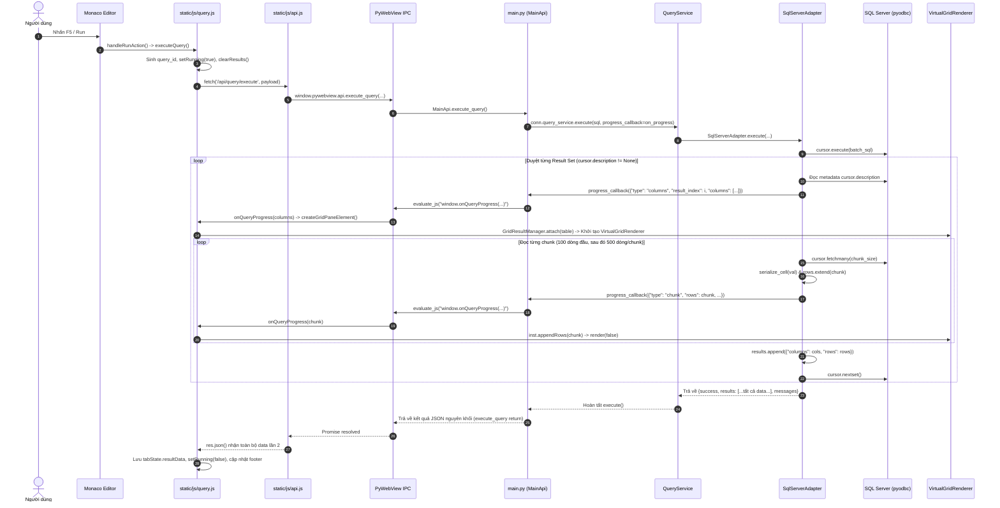
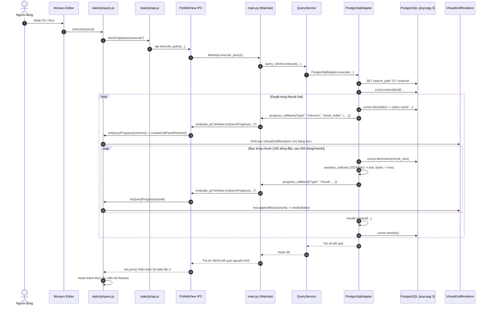

# BÁO CÁO PHÂN TÍCH KIẾN TRÚC TRẢ KẾT QUẢ SQL VỀ RESULT GRID

> **Tham chiếu Task:** [`.SKILL/research_result_grid.md`](file:///d:/Luong/NB_Personal/Python/IDE-SQL-Lite_New_Pyweb/.SKILL/research_result_grid.md)  
> **Phương pháp phân tích:** Read-Only Source Code Analysis (Đối chiếu trực tiếp mã nguồn thực tế).

---

## Phần 1. Tổng quan kiến trúc hiện tại

Hệ thống IDE hoạt động theo mô hình ứng dụng Desktop Native lai (Hybrid Desktop App):
1. **Frontend:** Single Page Application (SPA) xây dựng bằng Vanilla JavaScript, HTML5 và CSS chạy trong WebView2 (EdgeChromium).
2. **Cầu nối IPC (Native Bridge):** Thư viện `pywebview` cung cấp đối tượng `window.pywebview.api` liên kết với lớp `MainApi` trong Python. File [`static/js/api.js`](file:///d:/Luong/NB_Personal/Python/IDE-SQL-Lite_New_Pyweb/static/js/api.js) ghi đè hàm `window.fetch` toàn cục để chuyển hướng các API `/api/...` về các lời gọi IPC bất đồng bộ mà không cần mở cổng TCP/HTTP socket cục bộ.
3. **Backend:** Python 3 quản lý kết nối cơ sở dữ liệu thông qua [`ConnectionManager`](file:///d:/Luong/NB_Personal/Python/IDE-SQL-Lite_New_Pyweb/app/services/connection_manager.py) và [`QueryService`](file:///d:/Luong/NB_Personal/Python/IDE-SQL-Lite_New_Pyweb/app/services/query_service.py).
4. **Database Adapters:**
   - SQL Server: Dùng driver `pyodbc` qua [`SqlServerAdapter`](file:///d:/Luong/NB_Personal/Python/IDE-SQL-Lite_New_Pyweb/app/database/sqlserver.py).
   - PostgreSQL: Dùng driver `psycopg` (v3) qua [`PostgreSqlAdapter`](file:///d:/Luong/NB_Personal/Python/IDE-SQL-Lite_New_Pyweb/app/database/postgresql.py).
5. **Cơ chế truyền dữ liệu (Streaming & Return Payload kép):**
   - **Giai đoạn 1 (Streaming tiến trình):** Trong quá trình driver đọc dữ liệu bằng `cursor.fetchmany()`, backend gọi hàm callback `on_progress` qua `webview.windows[].evaluate_js()` để đẩy từng chunk (100 dòng đầu, sau đó 500 dòng/chunk) sang JavaScript kích hoạt hàm `window.onQueryProgress()`.
   - **Giai đoạn 2 (Return Payload nguyên khối):** Đồng thời, backend **vẫn tích luỹ toàn bộ** các dòng vào một mảng `results` trong bộ nhớ Python và trả về toàn bộ payload kết quả khổng lồ này khi Promise của `execute_query` kết thúc.
6. **Result Grid DOM & Virtualization:**
   - Mỗi result set được gắn vào một phần tử bảng riêng biệt thông qua [`GridResultManager.attach()`](file:///d:/Luong/NB_Personal/Python/IDE-SQL-Lite_New_Pyweb/static/js/grid-result.js#L2264).
   - Đã có cơ chế ảo hóa dòng ([`VirtualGridRenderer`](file:///d:/Luong/NB_Personal/Python/IDE-SQL-Lite_New_Pyweb/static/js/grid-result.js#L115)) sử dụng spacer trên/dưới và hồ chứa dòng DOM cố định (`rowPool` khoảng 25–40 dòng). Tuy nhiên, mỗi result set sở hữu một `VirtualGridRenderer` riêng và một `ResizeObserver` riêng.

---

## Phần 2. Danh sách file và thành phần liên quan

| File path | Class / Function | Vai trò | Dòng code |
|---|---|---|---|
| [`static/js/query.js`](file:///d:/Luong/NB_Personal/Python/IDE-SQL-Lite_New_Pyweb/static/js/query.js) | `handleRunAction` | Lắng nghe click nút Run hoặc phím tắt F5 / Ctrl+E để kích hoạt truy vấn | L2560–2580 |
| [`static/js/query.js`](file:///d:/Luong/NB_Personal/Python/IDE-SQL-Lite_New_Pyweb/static/js/query.js) | `executeQuery` | Thu thập câu lệnh SQL từ Monaco Editor, trạng thái tab, khởi tạo ID truy vấn và gọi API thực thi | L1273–1770 |
| [`static/js/query.js`](file:///d:/Luong/NB_Personal/Python/IDE-SQL-Lite_New_Pyweb/static/js/query.js) | `window.onQueryProgress` | Hook nhận sự kiện streaming từ Python IPC (`columns`, `chunk`), cập nhật DOM và footer | L1090–1171 |
| [`static/js/query.js`](file:///d:/Luong/NB_Personal/Python/IDE-SQL-Lite_New_Pyweb/static/js/query.js) | `createGridPaneElement` | Khởi tạo cấu trúc DOM cho một pane bảng: thẻ `table`, `thead`, tiêu đề cột, resizer cột, nút lọc và gắn `GridResultManager` | L915–1087 |
| [`static/js/query.js`](file:///d:/Luong/NB_Personal/Python/IDE-SQL-Lite_New_Pyweb/static/js/query.js) | `renderGrid` | Hàm dựng giao diện cho danh sách các result set tĩnh (fallback khi không dùng streaming hoặc khi restore tab) | L2127–2254 |
| [`static/js/query.js`](file:///d:/Luong/NB_Personal/Python/IDE-SQL-Lite_New_Pyweb/static/js/query.js) | `cancelQuery` | Gửi yêu cầu dừng truy vấn đang chạy sang backend | L870–890 |
| [`static/js/api.js`](file:///d:/Luong/NB_Personal/Python/IDE-SQL-Lite_New_Pyweb/static/js/api.js) | `global.fetch` (override) | Chặn các URL `/api/query/execute` và chuyển hướng thành `api.execute_query(...)` qua PyWebView Bridge | L57–85, L221–232 |
| [`main.py`](file:///d:/Luong/NB_Personal/Python/IDE-SQL-Lite_New_Pyweb/main.py) | `MainApi.execute_query` | Nhận yêu cầu từ JS, khởi tạo `on_progress` callback qua `w.evaluate_js()`, điều phối thực thi tới `QueryService` | L3309–3341 |
| [`main.py`](file:///d:/Luong/NB_Personal/Python/IDE-SQL-Lite_New_Pyweb/main.py) | `main` | Khởi tạo cửa sổ PyWebView với GUI EdgeChromium, gắn `MainApi` vào `js_api` | L4012–4025, L4124 |
| [`app/services/query_service.py`](file:///d:/Luong/NB_Personal/Python/IDE-SQL-Lite_New_Pyweb/app/services/query_service.py) | `QueryService.execute` | Quản lý lock phiên (`session.lock`) và ủy quyền gọi `adapter.execute()` | L6–30 |
| [`app/database/sqlserver.py`](file:///d:/Luong/NB_Personal/Python/IDE-SQL-Lite_New_Pyweb/app/database/sqlserver.py) | `SqlServerAdapter.execute` | Tách lệnh `GO`, thực thi bằng `pyodbc`, duyệt `cursor.description`, đọc batch qua `fetchmany()`, lặp `nextset()` | L269–465 |
| [`app/database/sqlserver.py`](file:///d:/Luong/NB_Personal/Python/IDE-SQL-Lite_New_Pyweb/app/database/sqlserver.py) | `serialize_cell` | Tuần tự hóa kiểu dữ liệu tế vi (bytes sang hex `0x...`, chuỗi, số, None) | L23–31 |
| [`app/database/postgresql.py`](file:///d:/Luong/NB_Personal/Python/IDE-SQL-Lite_New_Pyweb/app/database/postgresql.py) | `PostgreSqlAdapter.execute` | Đặt `search_path`, thực thi bằng `psycopg`, đọc batch qua `fetchmany()`, lặp `nextset()`, bắt notice | L91–253 |
| [`app/database/postgresql.py`](file:///d:/Luong/NB_Personal/Python/IDE-SQL-Lite_New_Pyweb/app/database/postgresql.py) | `serialize_cell` | Tuần tự hóa dữ liệu PostgreSQL (JSON/dict, bytes, boolean, text) | L9–20 |
| [`static/js/grid-result.js`](file:///d:/Luong/NB_Personal/Python/IDE-SQL-Lite_New_Pyweb/static/js/grid-result.js) | `VirtualGridRenderer` | Quản lý ảo hóa dòng trong bảng: spacer top/bottom, pool dòng DOM (`rowPool`), scroll listener, `ResizeObserver` | L115–280 |
| [`static/js/grid-result.js`](file:///d:/Luong/NB_Personal/Python/IDE-SQL-Lite_New_Pyweb/static/js/grid-result.js) | `GridResultInstance` | Quản lý trạng thái một bảng: tập dòng dữ liệu, vùng chọn cell, lọc cột, tìm kiếm, context menu | L283–376 |
| [`static/js/grid-result.js`](file:///d:/Luong/NB_Personal/Python/IDE-SQL-Lite_New_Pyweb/static/js/grid-result.js) | `GridResultManager` | Điểm truy cập toàn cục: quản lý vòng đời và lưu trữ các thực thể grid theo từng thẻ `table` qua `WeakMap` | L2261–2276 |
| [`static/js/app.js`](file:///d:/Luong/NB_Personal/Python/IDE-SQL-Lite_New_Pyweb/static/js/app.js) | Horizontal Resizer Handler | Xử lý kéo thanh phân cách ngang giữa Monaco Editor và Results Panel (`.ide-resizer-horizontal`) | L193–251 |

---

## Phần 3. Luồng xử lý SQL Server

### 3.1. Sơ đồ tuần tự Mermaid (SQL Server)


### 3.2. Chi tiết từng công đoạn
1. **Khởi tạo phía Frontend:**
   - Người dùng nhấn nút Run ([`query.js:L2612`](file:///d:/Luong/NB_Personal/Python/IDE-SQL-Lite_New_Pyweb/static/js/query.js#L2612)) hoặc phím tắt F5 ([`query.js:L2583`](file:///d:/Luong/NB_Personal/Python/IDE-SQL-Lite_New_Pyweb/static/js/query.js#L2583)).
   - `executeQuery()` ([`query.js:L1273`](file:///d:/Luong/NB_Personal/Python/IDE-SQL-Lite_New_Pyweb/static/js/query.js#L1273)) kiểm tra `resultPanelState.isRunning`. Nếu đang chạy thì ngắt.
   - Lấy text SQL đang chọn hoặc toàn bộ file, sinh `currentExecutingQueryId` dạng `'q_' + Date.now() + '_' + Math.random()` ([`query.js:L1519`](file:///d:/Luong/NB_Personal/Python/IDE-SQL-Lite_New_Pyweb/static/js/query.js#L1519)).
   - Gọi `fetch('/api/query/execute', ...)` ([`query.js:L1559`](file:///d:/Luong/NB_Personal/Python/IDE-SQL-Lite_New_Pyweb/static/js/query.js#L1559)).
2. **Cầu nối IPC sang Python:**
   - [`api.js:L221-232`](file:///d:/Luong/NB_Personal/Python/IDE-SQL-Lite_New_Pyweb/static/js/api.js#L221-L232) đón URL `/api/query/execute` và chuyển thành `await api.execute_query(connId, sql, limit, database, schema, query_id)`.
   - Lớp `MainApi.execute_query()` ([`main.py:L3309`](file:///d:/Luong/NB_Personal/Python/IDE-SQL-Lite_New_Pyweb/main.py#L3309)) định nghĩa hàm con `on_progress(event)` và chuyển việc cho `conn.query_service.execute()` ([`main.py:L3328`](file:///d:/Luong/NB_Personal/Python/IDE-SQL-Lite_New_Pyweb/main.py#L3328)).
3. **Thực thi trong Adapter SQL Server:**
   - Driver sử dụng là `pyodbc` kết nối qua `ODBC Driver 18 for SQL Server` (tự động fallback về Driver 17 nếu lỗi kết nối), chế độ `autocommit = True` ([`sqlserver.py:L170-192`](file:///d:/Luong/NB_Personal/Python/IDE-SQL-Lite_New_Pyweb/app/database/sqlserver.py#L170-L192)).
   - SQL được phân tách theo khối `GO` bằng Regex đa dòng ([`sqlserver.py:L285`](file:///d:/Luong/NB_Personal/Python/IDE-SQL-Lite_New_Pyweb/app/database/sqlserver.py#L285)).
   - `cursor.execute(batch_sql)` ([`sqlserver.py:L333`](file:///d:/Luong/NB_Personal/Python/IDE-SQL-Lite_New_Pyweb/app/database/sqlserver.py#L333)).
   - Duyệt vòng lặp `while True`: nếu `cursor.description` có dữ liệu, trích xuất tên cột `columns = [desc[0] for desc in cursor.description]` ([`sqlserver.py:L339`](file:///d:/Luong/NB_Personal/Python/IDE-SQL-Lite_New_Pyweb/app/database/sqlserver.py#L339)).
   - Nếu có `progress_callback`:
     - Gửi event `type: "columns"`.
     - Vòng lặp đọc chunk: đợt đầu lấy 100 dòng, các đợt sau 500 dòng (`chunk_size = 100 if first_chunk else 500`) bằng lệnh `cursor.fetchmany(chunk_size)` ([`sqlserver.py:L358-366`](file:///d:/Luong/NB_Personal/Python/IDE-SQL-Lite_New_Pyweb/app/database/sqlserver.py#L358-L366)).
     - Gọi hàm chuyển đổi kiểu [`serialize_cell()`](file:///d:/Luong/NB_Personal/Python/IDE-SQL-Lite_New_Pyweb/app/database/sqlserver.py#L23) chuyển đổi dữ liệu bytes/binary sang dạng hex string `0x...`, chuỗi và số nguyên.
     - Tích luỹ chunk vào mảng `rows` và gọi `progress_callback({"type": "chunk", "rows": serialized_chunk, ...})`.
   - Kết thúc result set: thêm vào mảng tổng `results.append(...)` và gọi `cursor.nextset()` ([`sqlserver.py:L404`](file:///d:/Luong/NB_Personal/Python/IDE-SQL-Lite_New_Pyweb/app/database/sqlserver.py#L404)).

---

## Phần 4. Luồng xử lý PostgreSQL

### 4.1. Sơ đồ tuần tự Mermaid (PostgreSQL)


### 4.2. Chi tiết từng công đoạn
1. **Driver & Kết nối:**
   - Sử dụng thư viện `psycopg` (psycopg version 3) với `autocommit = True` ([`postgresql.py:L31-41`](file:///d:/Luong/NB_Personal/Python/IDE-SQL-Lite_New_Pyweb/app/database/postgresql.py#L31-L41)).
   - Đăng ký bộ lọc thông điệp NOTICE từ server PostgreSQL thông qua `connection.add_notice_handler(notice_callback)` ([`postgresql.py:L114-119`](file:///d:/Luong/NB_Personal/Python/IDE-SQL-Lite_New_Pyweb/app/database/postgresql.py#L114-L119)).
2. **Thực thi truy vấn & chuyển đổi kiểu:**
   - Trước khi thực thi, adapter ép chặt không gian schema: `SET search_path TO "target_schema"` ([`postgresql.py:L132`](file:///d:/Luong/NB_Personal/Python/IDE-SQL-Lite_New_Pyweb/app/database/postgresql.py#L132)).
   - Driver gửi nguyên khối chuỗi SQL có thể chứa nhiều câu lệnh tới Postgres thông qua `cursor.execute(sql)` ([`postgresql.py:L143`](file:///d:/Luong/NB_Personal/Python/IDE-SQL-Lite_New_Pyweb/app/database/postgresql.py#L143)).
   - Metadata cột lấy từ `[desc.name for desc in cursor.description]` ([`postgresql.py:L148`](file:///d:/Luong/NB_Personal/Python/IDE-SQL-Lite_New_Pyweb/app/database/postgresql.py#L148)).
   - Hàm `serialize_cell()` ([`postgresql.py:L9-20`](file:///d:/Luong/NB_Personal/Python/IDE-SQL-Lite_New_Pyweb/app/database/postgresql.py#L9-L20)) xử lý đặc thù cho PostgreSQL: nếu cột là kiểu mảng hoặc kiểu JSON/dict, tự động chuyển đổi thành chuỗi JSON `json.dumps(val, ensure_ascii=False)`.

---

## Phần 5. Cơ chế xử lý nhiều result set

### 5.1. Bảng so sánh SQL Server vs PostgreSQL

| Tiêu chí | SQL Server | PostgreSQL |
|---|---|---|
| **Driver xử lý** | `pyodbc` | `psycopg` (v3) |
| **Phân tách câu lệnh** | Cắt batch theo từ khóa `GO` bằng Regex trước, sau đó trong mỗi batch chạy `nextset()` | Gửi nguyên khối SQL tới server, dựa hoàn toàn vào giao thức multi-statement của server và `cursor.nextset()` |
| **Cơ chế chuyển result set** | `cursor.nextset()` ([`sqlserver.py:L404`](file:///d:/Luong/NB_Personal/Python/IDE-SQL-Lite_New_Pyweb/app/database/sqlserver.py#L404)) | `cursor.nextset()` ([`postgresql.py:L212`](file:///d:/Luong/NB_Personal/Python/IDE-SQL-Lite_New_Pyweb/app/database/postgresql.py#L212)) |
| **Procedure / Function trả về nhiều tập kết quả** | Hỗ trợ tự nhiên: một thủ tục gọi nhiều lệnh SELECT sẽ trả về liên tiếp các tập kết quả qua `nextset()` | Function trả về `refcursor` **không** tự động bung thành nhiều result set qua `nextset()` trừ khi script gồm nhiều câu lệnh SELECT thực thi đồng thời trong phiên |
| **Định danh result set** | Chỉ số nguyên tuần tự `res_index = len(results)` (0, 1, 2...) | Chỉ số nguyên tuần tự `res_index = len(results)` (0, 1, 2...) |
| **Bảo lưu thông điệp/NOTICE** | Thu thập qua `cursor.messages` sau mỗi batch và mỗi lần gọi `nextset()` ([`sqlserver.py:L316-324`](file:///d:/Luong/NB_Personal/Python/IDE-SQL-Lite_New_Pyweb/app/database/sqlserver.py#L316-L324)) | Thu thập qua hook bất đồng bộ `notice_handler` của psycopg connection ([`postgresql.py:L107-113`](file:///d:/Luong/NB_Personal/Python/IDE-SQL-Lite_New_Pyweb/app/database/postgresql.py#L107-L113)) |
| **Xử lý câu lệnh không trả data (DML/DDL)** | Nhánh `else: rc = cursor.rowcount` ghi nhận số dòng ảnh hưởng, không đẩy result set rỗng sang grid | Nhánh `else: rc = cursor.rowcount` ghi nhận số dòng ảnh hưởng, không đẩy result set rỗng sang grid |
| **Xử lý lỗi giữa chừng** | Bắt ngoại lệ tại `nextset_err` ([`sqlserver.py:L406`](file:///d:/Luong/NB_Personal/Python/IDE-SQL-Lite_New_Pyweb/app/database/sqlserver.py#L406)), lưu các result set trước đó, đưa thông tin lỗi vào mảng `errors` | Ngoại lệ ở statement sau sẽ kích hoạt khối `except pg_err` ([`postgresql.py:L217`](file:///d:/Luong/NB_Personal/Python/IDE-SQL-Lite_New_Pyweb/app/database/postgresql.py#L217)), bảo lưu các result set đã đọc trước đó |

### 5.2. Luồng thông báo và dựng giao diện khi có nhiều Result Set
- **Thời điểm Frontend được thông báo:**
  Backend đọc tuần tự. Khi bắt đầu duyệt result set thứ $i$, backend bắn sự kiện `{"type": "columns", "result_index": i, "columns": [...]}`.
- **Tại Frontend (`window.onQueryProgress`):**
  - Khi nhận `type: "columns"`, nếu `currentStreamingData.grids[resIdx]` chưa có, frontend gọi ngay `createGridPaneElement()` ([`query.js:L1143`](file:///d:/Luong/NB_Personal/Python/IDE-SQL-Lite_New_Pyweb/static/js/query.js#L1143)).
  - Một phần tử DOM `.ide-grid-pane` mới được tạo ra và append trực tiếp vào container kết quả.
  - Sau đó, khi các chunk thuộc `resIdx` đó được đẩy về, frontend gọi `inst.appendRows(evt.rows)` vào đúng bảng đó.
- **Lỗ hổng layout khi streaming nhiều result set:**
  Trong `onQueryProgress` ([`query.js:L1143`](file:///d:/Luong/NB_Personal/Python/IDE-SQL-Lite_New_Pyweb/static/js/query.js#L1143)), `createGridPaneElement` được gọi với tham số `totalGrids = 1` và chiều cao cố định `'100%'`. Khi có từ 2 result set trở lên cùng xuất hiện trong một lượt streaming, các pane này bị gán cùng chiều cao `100%` và `flex: 1 1 100%`, **hoàn toàn không được chèn thanh chia splitter**. Chỉ khi chạy chế độ render tĩnh (`renderGrid` tại [`query.js:L2180`](file:///d:/Luong/NB_Personal/Python/IDE-SQL-Lite_New_Pyweb/static/js/query.js#L2180)) thì thanh `.ide-grid-splitter` mới được tạo giữa các pane.

---

## Phần 6. Cơ chế DOM rendering hiện tại

### 6.1. Cấu trúc cây DOM của một bảng kết quả
```text
div.ide-tab-grid-wrap (Container chứa các bảng)
  │
  ├── div.ide-grid-pane (data-grid-index="0")
  │     ├── div.ide-result-filter-bar
  │     └── div.ide-grid-table-scroll (Vùng cuộn có overflow)
  │           └── table.ide-results-table
  │                 ├── thead
  │                 │     └── tr
  │                 │           ├── th.ide-row-number (Nút chọn tất cả)
  │                 │           └── th (style="width: ...px")
  │                 │                 ├── div.ide-th-content (Tên cột + Nút lọc)
  │                 │                 └── span.col-resizer (Kéo chỉnh độ rộng cột)
  │                 └── tbody
  │                       ├── tr.ide-virtual-spacer-top (style="height: X px")
  │                       ├── tr (Pool dòng 0) -> [td.ide-row-number, td, td...]
  │                       ├── tr (Pool dòng 1) -> [td.ide-row-number, td, td...]
  │                       │   ... (~25 - 40 dòng DOM)
  │                       └── tr.ide-virtual-spacer-bottom (style="height: Y px")
  │
  ├── div.ide-grid-splitter (Thanh kéo phân cách giữa các bảng - nếu render tĩnh)
  │
  └── div.ide-grid-pane (data-grid-index="1")
        └── ...
```

### 6.2. Cơ chế Ảo hóa Dòng (`VirtualGridRenderer`)
Khảo sát chi tiết lớp `VirtualGridRenderer` ([`grid-result.js:L115-280`](file:///d:/Luong/NB_Personal/Python/IDE-SQL-Lite_New_Pyweb/static/js/grid-result.js#L115-L280)):
1. **Khởi tạo Spacers:**
   - Tạo `topSpacer` và `bottomSpacer` dạng thẻ `<tr>` chứa một thẻ `<td>` có `colSpan = totalCols + 1`. Chiều cao của 2 thẻ này đóng vai trò bù đắp không gian cuộn cho các dòng nằm ngoài khung nhìn.
2. **Hồ chứa dòng DOM (`rowPool`):**
   - Số dòng DOM tồn tại trong `tbody` được giới hạn nghiêm ngặt theo công thức:
     $$\text{neededRows} = \text{endIndex} - \text{startIndex} = \lceil\text{viewportH} / \text{rowHeight}\rceil + 2 \times \text{buffer}$$
     (Với `rowHeight = 26px`, `buffer = 10`, một viewport 400px chỉ tạo ra khoảng $16 + 20 = 36$ thẻ `<tr>`).
   - Các thẻ `<tr>` thừa khi co nhỏ màn hình được ẩn bằng `style.display = 'none'` ([`grid-result.js:L259`](file:///d:/Luong/NB_Personal/Python/IDE-SQL-Lite_New_Pyweb/static/js/grid-result.js#L259)), không bị xóa khỏi DOM nhằm tránh chi phí Garbage Collection.
3. **Cập nhật nội dung dòng (`updateRowCells`):**
   - Khi cuộn hoặc render lại, hàm `updateRowCells(tr, displayRowIdx)` ([`grid-result.js:L419-501`](file:///d:/Luong/NB_Personal/Python/IDE-SQL-Lite_New_Pyweb/static/js/grid-result.js#L419-L501)) gán lại giá trị cho các ô `<td>` đã có sẵn trong `tr`.
   - Cập nhật số thứ tự dòng, class chẵn/lẻ (`ide-row-alt`), class lựa chọn (`selected`, `active-cell`), và nội dung ô (sử dụng `td.textContent` cho số/chữ hoặc `td.innerHTML` cho giá trị `NULL`).
4. **Không ảo hóa cột (Horizontal Virtualization):**
   - Hệ thống **chỉ ảo hóa chiều dọc (dòng)**, **không ảo hóa chiều ngang (cột)**.
   - Nếu truy vấn trả về 100 cột, mỗi dòng trong `rowPool` sẽ chứa đầy đủ 100 thẻ `<td>`.

---

## Phần 7. Cơ chế resize hiện tại

### 7.1. Toàn bộ các luồng Resize đang tồn tại trong hệ thống
Có 3 cấp độ resize tác động trực tiếp lên Result Grid:
1. **Cấp 1: Kéo thanh phân chia Results Panel với Monaco Editor (`.ide-resizer-horizontal`)**
   - Mã nguồn: [`static/js/app.js:L193-251`](file:///d:/Luong/NB_Personal/Python/IDE-SQL-Lite_New_Pyweb/static/js/app.js#L193-L251).
   - Sự kiện: Lắng nghe `pointerdown`, `pointermove`, `pointerup` trên thẻ `div.ide-resizer-horizontal`.
   - Cơ chế điều phối: Sử dụng `requestAnimationFrame` ([`app.js:L232`](file:///d:/Luong/NB_Personal/Python/IDE-SQL-Lite_New_Pyweb/static/js/app.js#L232)) để gán trực tiếp:
     ```javascript
     editorPane.style.setProperty('flex', 'none', 'important');
     editorPane.style.height = newH + 'px';
     ```
2. **Cấp 2: Kéo thanh phân chia giữa các bảng kết quả (`.ide-grid-splitter`)**
   - Mã nguồn: [`static/js/query.js:L2185-2210`](file:///d:/Luong/NB_Personal/Python/IDE-SQL-Lite_New_Pyweb/static/js/query.js#L2185-L2210).
   - Sự kiện: Lắng nghe `pointerdown`, `pointermove` trên thẻ `div.ide-grid-splitter`.
   - **Đặc điểm bất lợi:** Callback `onPointerMove` ([`query.js:L2193`](file:///d:/Luong/NB_Personal/Python/IDE-SQL-Lite_New_Pyweb/static/js/query.js#L2193)) **không có `requestAnimationFrame` hay bất kỳ cơ chế throttle nào**. Mỗi cử chỉ di chuột kích hoạt gán `pane.style.height = newH + 'px'` liên tục với tần số chuột (60–120Hz).
3. **Cấp 3: Kéo độ rộng từng cột trong header (`.col-resizer`)**
   - Mã nguồn: [`static/js/query.js:L1027-1056`](file:///d:/Luong/NB_Personal/Python/IDE-SQL-Lite_New_Pyweb/static/js/query.js#L1027-L1056).
   - Sự kiện: Lắng nghe `pointermove`, có bọc cờ `pendingResize` và `requestAnimationFrame` để gán `th.style.width = latestWidth + 'px'`.

### 7.2. Trả lời chi tiết 10 câu hỏi cốt lõi về Resize

#### 1. Sự kiện resize kích hoạt những hàm nào?
- Khi kéo thanh ngang (`hResizer`): `pointermove` -> `rAF` cập nhật chiều cao `editorPane`. Vì container cha là flexbox, sự kiện này làm thay đổi kích thước của `ide-result-panel` và các vùng chứa con `.ide-grid-table-scroll`.
- Sự thay đổi kích thước của mỗi `.ide-grid-table-scroll` kích hoạt callback của `ResizeObserver` ([`grid-result.js:L182`](file:///d:/Luong/NB_Personal/Python/IDE-SQL-Lite_New_Pyweb/static/js/grid-result.js#L182)).
- Callback này kích hoạt: `rAF` -> `VirtualGridRenderer.render(true)` (với cờ ép buộc `force = true`).
- `render(true)` gọi: `updateRowCells()` cho toàn bộ các dòng hiển thị trong `rowPool`.

#### 2. Một lần kéo thanh phân chia có thể gọi hàm cập nhật layout bao nhiêu lần?
- Với thanh chia chính (`.ide-resizer-horizontal`): được đồng bộ qua `requestAnimationFrame` nên gọi khoảng 60 lần/giây.
- Với thanh chia giữa các bảng (`.ide-grid-splitter`): chạy trực tiếp trên `pointermove`, có thể gọi từ **60 đến 140 lần/giây** tùy tần số lấy mẫu của chuột.

#### 3. Khi resize, có duyệt qua tất cả result set không?
- **CÓ.** Vì mỗi result set sở hữu một `.ide-grid-table-scroll` nằm trong cùng một flex container, khi chiều cao tổng thể thay đổi, **tất cả** các `ResizeObserver` của tất cả các result set đồng loạt kích hoạt trong cùng một chu kỳ render.

#### 4. Có dựng lại DOM của grid không?
- **KHÔNG.** `VirtualGridRenderer` tái sử dụng mảng `rowPool` (chỉ thay đổi thuộc tính `style.display`, `style.height` của spacer và nội dung cell qua `updateRowCells`). Thẻ `table` và `thead` không bị dựng lại từ đầu.

#### 5. Có tính toán lại chiều rộng tất cả cột không?
- **KHÔNG.** Chiều rộng cột được cố định bằng inline style dạng `px` trên các thẻ `<th>` ([`query.js:L995`](file:///d:/Luong/NB_Personal/Python/IDE-SQL-Lite_New_Pyweb/static/js/query.js#L995)). Trình duyệt sử dụng layout bảng mặc định để giữ nguyên chiều rộng các cột này.

#### 6. Có đọc layout rồi ghi layout liên tục trong cùng một vòng xử lý không?
- **CÓ (Hiện tượng Layout Thrashing nghiêm trọng):**
  Quan sát bên trong [`VirtualGridRenderer.render()` dòng 208–238](file:///d:/Luong/NB_Personal/Python/IDE-SQL-Lite_New_Pyweb/static/js/grid-result.js#L208-L238):
  - **Đọc 1:** `this.rowPool[0].offsetHeight` (Dòng 208) -> Ép trình duyệt tính toán reflow ngay lập tức.
  - **Đọc 2:** `this.scrollContainer.clientHeight` (Dòng 216) -> Đọc chiều cao khung cuộn.
  - **Ghi 1:** `this.topSpacer.style.height = ...` (Dòng 232) -> Vô hiệu hóa layout vừa tính.
  - **Ghi 2:** `this.bottomSpacer.style.height = ...` (Dòng 236) -> Vô hiệu hóa layout tiếp.
  - Khi có $N$ result set, trình duyệt bị bắt buộc thực hiện chuỗi xen kẽ: **Đọc -> Đọc -> Ghi -> Ghi** lặp lại $N$ lần trong cùng một khung hình render.

#### 7. Có hiện tượng nhiều ResizeObserver cùng theo dõi một vùng không?
- **CÓ.** Mỗi result set tạo ra một instance `VirtualGridRenderer`, và mỗi instance tự khởi tạo một `new ResizeObserver()` theo dõi phần tử `.ide-grid-table-scroll` của riêng nó ([`grid-result.js:L182`](file:///d:/Luong/NB_Personal/Python/IDE-SQL-Lite_New_Pyweb/static/js/grid-result.js#L182)). Nếu một lần chạy trả về 10 result set, sẽ có **10 đối tượng ResizeObserver độc lập** cùng hoạt động.

#### 8. Các grid đang ẩn có tiếp tục được resize không?
- **CÓ (Lãng phí tài nguyên trên tab ẩn):**
  Khi chuyển đổi tab editor, container của tab cũ được gán class `d-none` ([`query.js:L2137`](file:///d:/Luong/NB_Personal/Python/IDE-SQL-Lite_New_Pyweb/static/js/query.js#L2137)). Tuy nhiên, `ResizeObserver` của các bảng trong tab ẩn **không hề bị disconnect**.
  Khi resize cửa sổ chính, `ResizeObserver` của các tab ẩn vẫn kích hoạt. Đặc biệt, tại dòng 216 của [`grid-result.js`](file:///d:/Luong/NB_Personal/Python/IDE-SQL-Lite_New_Pyweb/static/js/grid-result.js#L216):
  ```javascript
  const viewportH = (this.scrollContainer && this.scrollContainer.clientHeight > 0) ? this.scrollContainer.clientHeight : 400;
  ```
  Vì tab ẩn có `clientHeight === 0`, code tự fallback về chiều cao giả định `400px` và **tiếp tục chạy hàm render, cập nhật dữ liệu cho 30–40 dòng DOM của tab đang ẩn!**

#### 9. Chi phí resize có tăng theo số dòng, số cột hay số lượng result set?
- **Không tăng theo tổng số dòng:** Nhờ cơ chế `rowPool` ảo hóa, dù bảng có 1.000 dòng hay 100.000 dòng thì số dòng DOM được render vẫn giữ nguyên (~36 dòng).
- **Tăng tuyến tính theo số cột ($C$):** Vì không có ảo hóa cột, mỗi dòng trong `rowPool` phải cập nhật lại toàn bộ $C$ ô `<td>`.
- **Tăng theo cấp số nhân theo số lượng Result Set ($N$):** Mỗi result set bổ sung một `ResizeObserver`, một chu kỳ Layout Thrashing riêng, và một tập `rowPool` riêng phải cập nhật đồng thời trên một frame.

#### 10. Có điểm nào khiến resize vô tình kích hoạt lại render hoặc xử lý dữ liệu không?
- **CÓ.** Bản thân `ResizeObserver` kích hoạt `this.render(true)` với cờ `force = true` ([`grid-result.js:L187`](file:///d:/Luong/NB_Personal/Python/IDE-SQL-Lite_New_Pyweb/static/js/grid-result.js#L187)). Cờ này bỏ qua điều kiện kiểm tra `startIndex === this.startIndex && endIndex === this.endIndex` (vốn dùng để tránh re-render khi cuộn), buộc toàn bộ các ô trong `rowPool` phải re-render lại nội dung dữ liệu từ mảng JavaScript nguồn.

---

## Phần 8. Quản lý dữ liệu và bộ nhớ

### 8.1. Cấu trúc lưu trữ và sự nhân bản dữ liệu
Dữ liệu của một lần thực thi SQL được sao chép và tồn tại đồng thời ở **4 tầng khác nhau**:

1. **Bộ nhớ Driver Database:** Bộ đệm của `pyodbc` / `psycopg`.
2. **Bộ nhớ Python Backend (`SqlServerAdapter` / `PostgreSqlAdapter`):**
   Mảng `rows` và danh sách `results` ([`sqlserver.py:L370, L390`](file:///d:/Luong/NB_Personal/Python/IDE-SQL-Lite_New_Pyweb/app/database/sqlserver.py#L370)). Bộ nhớ này tồn tại xuyên suốt quá trình đọc và đóng gói trả về.
3. **Bộ nhớ IPC Serialization:**
   Chuỗi JSON mã hóa trong lệnh gọi `evaluate_js` và payload trả về của `execute_query`.
4. **Bộ nhớ JavaScript Frontend:**
   - Trong `tabState.resultData` ([`query.js:L1601`](file:///d:/Luong/NB_Personal/Python/IDE-SQL-Lite_New_Pyweb/static/js/query.js#L1601)): Chứa toàn bộ dữ liệu thô nhận từ `res.json()`.
   - Trong `currentStreamingData.grids[i].resSet.rows` ([`query.js:L1142`](file:///d:/Luong/NB_Personal/Python/IDE-SQL-Lite_New_Pyweb/static/js/query.js#L1142)): Mảng chứa các dòng nhận từ streaming.
   - Trong `GridResultInstance.rows` ([`grid-result.js:L291`](file:///d:/Luong/NB_Personal/Python/IDE-SQL-Lite_New_Pyweb/static/js/grid-result.js#L291)): Tham chiếu trỏ vào `resSet.rows`.

### 8.2. Vòng đời dữ liệu và nguy cơ rò rỉ bộ nhớ
- **Thời điểm giải phóng dữ liệu cũ:**
  - Khi người dùng chạy câu lệnh mới: `executeQuery()` gọi `clearResults()` ([`query.js:L1515, L2257`](file:///d:/Luong/NB_Personal/Python/IDE-SQL-Lite_New_Pyweb/static/js/query.js#L1515)). Hàm này chỉ ẩn container (`classList.add('d-none')`) và gán `currentStreamingData = null`.
  - Đến khi sự kiện streaming đầu tiên tới hoặc `renderGrid()` chạy ([`query.js:L1112, L2142`](file:///d:/Luong/NB_Personal/Python/IDE-SQL-Lite_New_Pyweb/static/js/query.js#L1112)), mã nguồn mới duyệt qua các thẻ `table` cũ và gọi `inst.destroy()`, sau đó gọi `tabGridContainers[tabId].remove()`.
- **Quản lý Event Listener & DOM:**
  - `GridResultInstance.destroy()` ([`grid-result.js:L365`](file:///d:/Luong/NB_Personal/Python/IDE-SQL-Lite_New_Pyweb/static/js/grid-result.js#L365)) đã dọn dẹp `document.removeEventListener('mouseup', this._docMouseUp)` và gọi `renderer.destroy()`.
  - `VirtualGridRenderer.destroy()` ([`grid-result.js:L271`](file:///d:/Luong/NB_Personal/Python/IDE-SQL-Lite_New_Pyweb/static/js/grid-result.js#L271)) đã ngắt `scrollContainer.removeEventListener` và `this._resizeObserver.disconnect()`.
  - `GridResultManager` sử dụng `WeakMap` ([`grid-result.js:L2261`](file:///d:/Luong/NB_Personal/Python/IDE-SQL-Lite_New_Pyweb/static/js/grid-result.js#L2261)), giúp các đối tượng `GridResultInstance` được tự động thu hồi khi phần tử thẻ `table` bị loại bỏ khỏi DOM tree.
  - Khi đóng hẳn một tab editor (`ide-tab-closed`), listener tại dòng 37 của [`query.js`](file:///d:/Luong/NB_Personal/Python/IDE-SQL-Lite_New_Pyweb/static/js/query.js#L37) tiến hành hủy các instance và xóa sạch `tabGridContainers[tabId]`.
- **Kết luận rò rỉ bộ nhớ:**
  Không có bằng chứng về rò rỉ bộ nhớ vĩnh viễn (unbounded memory leak) khi đóng tab. Tuy nhiên, trong quá trình làm việc bình thường với nhiều tab đang mở, **mọi bảng của các tab trước đó đều được giữ nguyên vẹn trong DOM** (chỉ ẩn bằng `.d-none`), khiến bộ nhớ tiêu hao lũy kế theo số lượng tab mở.

---

## Phần 9. Các nút thắt hiệu năng có thể xảy ra

| ID | Thành phần | Hành vi hiện tại | Nguy cơ | Bằng chứng mã nguồn | Mức độ tin cậy |
|---|---|---|---|---|---|
| **A1** | Database Driver (SQL Server & Postgres) | Dùng `fetchmany(chunk_size)` theo batch (100 rồi 500 dòng) | Tối ưu việc nạp dữ liệu từ driver, không phải nguyên nhân nghẽn chính | [`sqlserver.py:L358`](file:///d:/Luong/NB_Personal/Python/IDE-SQL-Lite_New_Pyweb/app/database/sqlserver.py#L358), [`postgresql.py:L167`](file:///d:/Luong/NB_Personal/Python/IDE-SQL-Lite_New_Pyweb/app/database/postgresql.py#L167) | Đã xác minh từ code |
| **B1** | Python Backend & Return Payload | Giữ toàn bộ dữ liệu trong mảng `results` Python và trả về toàn bộ payload JSON ở cuối `execute_query` | Gấp đôi chi phí bộ nhớ và gây lag đột ngột khi hoàn thành truy vấn | [`sqlserver.py:L453`](file:///d:/Luong/NB_Personal/Python/IDE-SQL-Lite_New_Pyweb/app/database/sqlserver.py#L453), [`main.py:L3338`](file:///d:/Luong/NB_Personal/Python/IDE-SQL-Lite_New_Pyweb/main.py#L3338) | Đã xác minh từ code |
| **C1** | PyWebView IPC Bridge | Gọi `w.evaluate_js(js)` tuần tự bằng chuỗi JavaScript thô để đẩy dữ liệu tiến trình | Chuỗi JSON bị nhúng trực tiếp vào mã JS, WebView2 phải compile/eval liên tục, gây nghẽn UI thread | [`main.py:L3319-3322`](file:///d:/Luong/NB_Personal/Python/IDE-SQL-Lite_New_Pyweb/main.py#L3319-L3322) | Đã xác minh từ code |
| **C2** | PyWebView IPC Bridge | Truyền dữ liệu dạng "kép": vừa streaming qua `evaluate_js`, vừa gửi lại 100% dữ liệu qua return payload của IPC | Tốn gấp đôi băng thông IPC và chi phí JSON serialization trên WebView2 | [`query.js:L1574`](file:///d:/Luong/NB_Personal/Python/IDE-SQL-Lite_New_Pyweb/static/js/query.js#L1574) & [`main.py:L3319`](file:///d:/Luong/NB_Personal/Python/IDE-SQL-Lite_New_Pyweb/main.py#L3319) | Đã xác minh từ code |
| **D1** | JavaScript Data Store | Lưu dữ liệu tại 3 vị trí: `tabState.resultData`, `currentStreamingData.grids`, `instance.rows` | Chi phí RAM của Chromium tăng gấp 3 lần kích thước dữ liệu thực tế | [`query.js:L1142, L1601`](file:///d:/Luong/NB_Personal/Python/IDE-SQL-Lite_New_Pyweb/static/js/query.js#L1142), [`grid-result.js:L291`](file:///d:/Luong/NB_Personal/Python/IDE-SQL-Lite_New_Pyweb/static/js/grid-result.js#L291) | Đã xác minh từ code |
| **E1** | DOM Rendering (Dòng) | Đã có ảo hóa dòng (`VirtualGridRenderer`) với pool ~36 dòng | Không bị nghẽn bởi số lượng dòng lớn (10.000 dòng vẫn mượt) | [`grid-result.js:L115-280`](file:///d:/Luong/NB_Personal/Python/IDE-SQL-Lite_New_Pyweb/static/js/grid-result.js#L115-L280) | Đã xác minh từ code |
| **E2** | DOM Rendering (Cột) | Không có ảo hóa cột; mỗi dòng trong pool chứa đủ 100% số cột | Nếu bảng có nhiều cột (>50 cột), mỗi lần render tốn rất nhiều phép gán DOM | [`grid-result.js:L249, L450`](file:///d:/Luong/NB_Personal/Python/IDE-SQL-Lite_New_Pyweb/static/js/grid-result.js#L249) | Có dấu hiệu nhưng cần đo đạc |
| **F1** | Multiple Result Set Management | Khởi tạo đồng thời tất cả các grid instances ngay khi nhận dữ liệu, không có cơ chế lazy rendering | Trình duyệt phải xử lý render và đo đạc cùng lúc nhiều bảng trên một trang | [`query.js:L1143`](file:///d:/Luong/NB_Personal/Python/IDE-SQL-Lite_New_Pyweb/static/js/query.js#L1143), [`query.js:L2176`](file:///d:/Luong/NB_Personal/Python/IDE-SQL-Lite_New_Pyweb/static/js/query.js#L2176) | Đã xác minh từ code |
| **F2** | Multiple Result Set Management | Khi streaming nhiều result set, không tạo thanh chia splitter; gán chiều cao 100% chồng lấn | Phá vỡ layout chuẩn khiến các bảng bị chèn ép chiều cao bất thường | [`query.js:L1143`](file:///d:/Luong/NB_Personal/Python/IDE-SQL-Lite_New_Pyweb/static/js/query.js#L1143) | Đã xác minh từ code |
| **G1** | Resize & Layout | Layout Thrashing trong `render(true)`: xen kẽ đọc `offsetHeight`/`clientHeight` và ghi `style.height` | Gây khựng/giật (frame drop) rõ rệt khi kéo thả thanh resizer | [`grid-result.js:L208-238`](file:///d:/Luong/NB_Personal/Python/IDE-SQL-Lite_New_Pyweb/static/js/grid-result.js#L208-L238) | Đã xác minh từ code |
| **G2** | Resize & Layout | Kéo thanh chia `.ide-grid-splitter` không dùng `requestAnimationFrame` hay throttle | Bắn hàng trăm sự kiện thay đổi layout mỗi giây khi di chuyển chuột | [`query.js:L2193-2198`](file:///d:/Luong/NB_Personal/Python/IDE-SQL-Lite_New_Pyweb/static/js/query.js#L2193-L2198) | Đã xác minh từ code |
| **G3** | Resize & Layout | `ResizeObserver` vẫn chạy trên các bảng thuộc tab đang ẩn và fallback về `viewportH = 400` | Tiêu tốn CPU vô ích để render lại các bảng mà người dùng không hề nhìn thấy | [`grid-result.js:L182, L216`](file:///d:/Luong/NB_Personal/Python/IDE-SQL-Lite_New_Pyweb/static/js/grid-result.js#L182) | Đã xác minh từ code |

---

## Phần 10. Kế hoạch đo đạc

Để kiểm chứng định lượng thời gian xử lý của từng nút thắt mà không cần can thiệp logic hay chạy SQL thực tế trên môi trường sản xuất, đề xuất kế hoạch đặt Performance Instrumentation như sau:

### 10.1. Điểm đo đạc phía Python Backend
- **T1 - Driver Fetch Time:** Đo thời gian `cursor.fetchmany()` trong vòng lặp đọc dữ liệu ([`sqlserver.py:L366`](file:///d:/Luong/NB_Personal/Python/IDE-SQL-Lite_New_Pyweb/app/database/sqlserver.py#L366), [`postgresql.py:L175`](file:///d:/Luong/NB_Personal/Python/IDE-SQL-Lite_New_Pyweb/app/database/postgresql.py#L175)) bằng `time.perf_counter()`.
- **T2 - Serialization Time:** Đo thời gian chạy hàm `serialize_cell` cho từng chunk.
- **T3 - IPC EvaluateJS Call:** Đo thời gian thực hiện `w.evaluate_js()` trong hàm `on_progress` ([`main.py:L3322`](file:///d:/Luong/NB_Personal/Python/IDE-SQL-Lite_New_Pyweb/main.py#L3322)).

### 10.2. Điểm đo đạc phía JavaScript Frontend
- **T4 - Progress Event Arrival:** Dùng `performance.now()` ghi nhận mốc thời gian nhận sự kiện `window.onQueryProgress` ([`query.js:L1090`](file:///d:/Luong/NB_Personal/Python/IDE-SQL-Lite_New_Pyweb/static/js/query.js#L1090)).
- **T5 - DOM Append / Update Time:** Đo thời gian thực thi của `inst.appendRows()` và `VirtualGridRenderer.render()`.
- **T6 - Resize Duration & Call Count:**
  - Đặt bộ đếm số lần gọi `onPointerMove` trên thanh `.ide-grid-splitter` ([`query.js:L2193`](file:///d:/Luong/NB_Personal/Python/IDE-SQL-Lite_New_Pyweb/static/js/query.js#L2193)).
  - Đặt cờ đo thời gian của `ResizeObserver` callback ([`grid-result.js:L182`](file:///d:/Luong/NB_Personal/Python/IDE-SQL-Lite_New_Pyweb/static/js/grid-result.js#L182)) và số lần `render(true)` được gọi trên mỗi frame.
- **T7 - Node Count & Memory:**
  - Đếm tổng số DOM nodes sinh ra: `document.querySelectorAll('.ide-tab-grid-wrap *').length`.
  - Đo kích thước mảng lưu trữ: `performance.memory.usedJSHeapSize` trước và sau khi render.

### 10.3. Phương pháp kiểm thử mô phỏng (Mock Test)
Tạo script kiểm thử giả lập dữ liệu ngoại tuyến (offline unit test) bằng Python:
1. Tạo mock cursor trả về 1, 5, 10 result sets với 10.000 dòng x 20 cột dữ liệu mẫu.
2. Đo thời gian serialize và thời gian truyền qua `evaluate_js` để phân tách rõ tỷ trọng thời gian giữa database engine và tầng hiển thị WebView2.

---

## Phần 11. Kết luận

Trả lời trực tiếp 8 câu hỏi cốt lõi theo yêu cầu:

### 1. Hiện tại dữ liệu được truyền theo cơ chế nào?
- **Cơ chế lai (Hybrid Streaming + Double Payload):**
  - **Tiến trình:** Chia batch ở backend Python (100 dòng đợt đầu, 500 dòng/đợt sau) và gọi `w.evaluate_js("window.onQueryProgress(...)")` sang frontend để thêm dần dòng vào grid.
  - **Kết thúc:** Khi truy vấn xong, toàn bộ kết quả tổng (100% dữ liệu) tiếp tục được đóng gói và trả về lần thứ 2 thông qua Promise của API `execute_query`.

### 2. Có virtual scrolling không?
- **CÓ.** Virtual scrolling cho chiều dọc (dòng) đã được xây dựng sẵn trong lớp [`VirtualGridRenderer`](file:///d:/Luong/NB_Personal/Python/IDE-SQL-Lite_New_Pyweb/static/js/grid-result.js#L115). Hệ thống sử dụng 2 spacer top/bottom và duy trì một hồ chứa dòng DOM cố định (`rowPool`) khoảng 25–40 dòng.
- **KHÔNG có virtual scrolling theo chiều ngang (cột).**

### 3. Có tạo DOM cho toàn bộ dữ liệu không?
- **KHÔNG tạo DOM cho toàn bộ dòng dữ liệu.** Số dòng DOM bị giới hạn theo khung nhìn.
- **Tuy nhiên, DOM cho toàn bộ cột thì được tạo đầy đủ** trên mỗi dòng thuộc `rowPool`.

### 4. Mỗi result set có grid instance riêng không?
- **CÓ.** Mỗi result set được tạo thành một thẻ `table` độc lập, sở hữu một `GridResultInstance` riêng và một `VirtualGridRenderer` riêng ([`query.js:L1069`](file:///d:/Luong/NB_Personal/Python/IDE-SQL-Lite_New_Pyweb/static/js/query.js#L1069), [`grid-result.js:L283`](file:///d:/Luong/NB_Personal/Python/IDE-SQL-Lite_New_Pyweb/static/js/grid-result.js#L283)).

### 5. Resize có kích hoạt render lại dữ liệu không?
- **CÓ.** Khi vùng kết quả thay đổi kích thước, `ResizeObserver` kích hoạt `render(true)` với cờ `force = true` ([`grid-result.js:L187`](file:///d:/Luong/NB_Personal/Python/IDE-SQL-Lite_New_Pyweb/static/js/grid-result.js#L187)), buộc toàn bộ các ô trong `rowPool` phải đọc lại dữ liệu từ mảng JavaScript và gán lại vào DOM.

### 6. Nút thắt nào đã được xác minh từ mã nguồn?
- **Nút thắt 1 (Layout Thrashing khi Resize):** Xen kẽ đọc `offsetHeight`/`clientHeight` và ghi `style.height` trong `VirtualGridRenderer.render()` ([`grid-result.js:L208-238`](file:///d:/Luong/NB_Personal/Python/IDE-SQL-Lite_New_Pyweb/static/js/grid-result.js#L208-L238)).
- **Nút thắt 2 (Kéo splitter không throttle):** Thanh chia `.ide-grid-splitter` giữa các bảng gọi trực tiếp `pane.style.height` trên sự kiện di chuột thô ([`query.js:L2193`](file:///d:/Luong/NB_Personal/Python/IDE-SQL-Lite_New_Pyweb/static/js/query.js#L2193)).
- **Nút thắt 3 (Truyền dữ liệu trùng lặp qua IPC):** Dữ liệu vừa được streaming qua `evaluate_js`, vừa được trả về nguyên khối qua return payload của `execute_query` ([`main.py:L3319, L3338`](file:///d:/Luong/NB_Personal/Python/IDE-SQL-Lite_New_Pyweb/main.py#L3319)).
- **Nút thắt 4 (ResizeObserver chạy ngầm trên tab ẩn):** Các bảng trong tab không kích hoạt vẫn tiếp tục render với chiều cao giả định 400px khi người dùng resize giao diện ([`grid-result.js:L182, L216`](file:///d:/Luong/NB_Personal/Python/IDE-SQL-Lite_New_Pyweb/static/js/grid-result.js#L182)).

### 7. Nút thắt nào cần đo đạc thêm?
- Chi phí IPC của WebView2 khi thực hiện `evaluate_js` với các chuỗi JSON lớn hơn 5MB so với việc gửi qua callback nhị phân.
- Ngưỡng suy giảm hiệu năng khi bảng có trên 50 cột (ảnh hưởng của việc thiếu ảo hóa cột).

### 8. Nên tối ưu thành phần nào trước?
1. **Ưu tiên 1 (Xử lý dứt điểm giật lag Resize):**
   - Loại bỏ thao tác đọc `this.rowPool[0].offsetHeight` trong vòng lặp render; cố định chiều cao dòng bằng cấu hình hằng số (26px).
   - Thêm `requestAnimationFrame` và throttle cho sự kiện kéo `.ide-grid-splitter`.
   - Ngắt hoặc bỏ qua (early exit) `ResizeObserver` khi phần tử đang bị ẩn (`offsetParent === null` hoặc có class `d-none`).
2. **Ưu tiên 2 (Tối ưu IPC Bridge & Bộ nhớ):**
   - Chấm dứt việc gửi lại toàn bộ dữ liệu qua return payload của `execute_query` nếu chế độ streaming đã hoàn tất việc nạp dữ liệu.
3. **Ưu tiên 3 (Đồng bộ Layout Multi-Result Set khi Streaming):**
   - Khởi tạo đúng tỷ lệ chiều cao và bổ sung thanh chia splitter chuẩn giữa các pane ngay trong quá trình nhận streaming nhiều tập kết quả.

---

## Phần 12. Danh sách câu hỏi chưa thể trả lời

Các vấn đề sau thuộc về hành vi thời gian thực và đặc thù môi trường phần cứng, không thể xác định chính xác 100% nếu chỉ thông qua đọc mã nguồn tĩnh:
1. **Độ trễ hàng đợi của EdgeChromium IPC:** Chưa đo được chi phí thời gian thực tế mà WebView2 tiêu tốn để parse chuỗi trong lệnh `window.evaluate_js()` khi tần số gọi đạt mức 100 chunk/giây.
2. **Mức tiêu hao VRAM của GPU:** Chưa thể xác minh GPU Acceleration của WebView2 xử lý việc vẽ lại các lớp (`compositing layers`) của các bảng kết quả như thế nào khi mở đồng thời nhiều tab có kết quả lớn.
3. **Giới hạn bộ nhớ tối đa của WebView2:** Chưa xác định được ngưỡng dung lượng dữ liệu (RAM) chính xác mà WebView2 trên máy tính của người dùng bắt đầu bị crash hoặc kích hoạt cơ chế tab discard.
