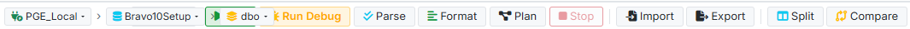
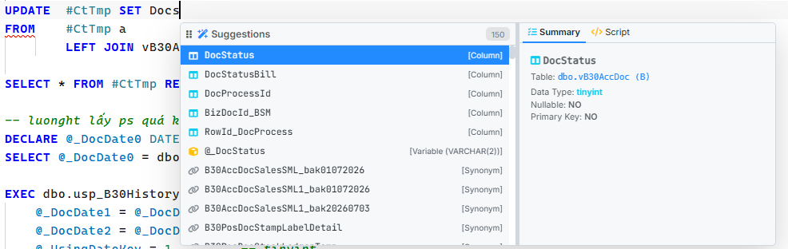

# Fix bugs and improve intellisense

## 1. Cải thiện intelisense trường hợp update. Ví dụ trong ảnh sau khi tôi đã nhập bảng đích update nhưng khi gợi ý cột vẫn gợi ý các cột cả bảng khác. Chỉnh lại theo nguyên tắc

- Cột đích update sẽ theo bảng đích update đã nhập (sau câu update) có thể là bảng/bảng tạm/alias của bảng update. (ảnh intelijsense)
- Cột update sẽ là các cột xuát hiện trong câu update. Có thể là chính bảng đó hoặc các bảng trong câu join

## 2. Chỉnh sửa tìm kiếm của text editor

- Hiện tại khi tôi tìm kiếm ở 1 màn hình text edior sau đó chuyển sang 1 tab khác thì k thể ấn được vào nội dụng tìm kiếm để gõ lại giá trị

## 3. Thiết kế reponsive cho action- bar

- Thực trạng theo ảnh action-bar: Khi co lại thì các chức năng chồng lên nhau. Xử lý khi co lại nếu k đủ hiển thị nội dùng thì sẽ chỉ hiển thị các chức năng gồm thông tin kết nối (connection/db/schena), nút run/run debug, chọn limit query còn chức năng còn lại đưa vào nút 3 chấm (...) (3 chấm căn phải)

## 4. Chuyển nút run debug thành dạng có xác nhận là có debug hay không (chỉ áp dụng cho kết nối postgress, kết nối khác mặc định chạy k debug)

- Hiển thị icon debug theo từ text editor hiện tại đang mở trên màn hình
- Chuyển nút run debug thành dạng có xác nhận (icon hình con bọ): Nếu postgres thì hiển thị nút này. Khi chọn debug thì hiển thị trạng thái debug
  - Active: Con bọ màu vàng (light-theme)/ Con bọ màu cam (dark-theme)
  - IsActive: Con bọ màu xám (dark-theme)/ Con bọ màu xám (dark-theme)
- Nếu là kết nối postgres và debug active => lúc này nút run sẽ là run debug
- Nếu là kết nối postgres và debug isactive => lúc này nút run sẽ là run normal
